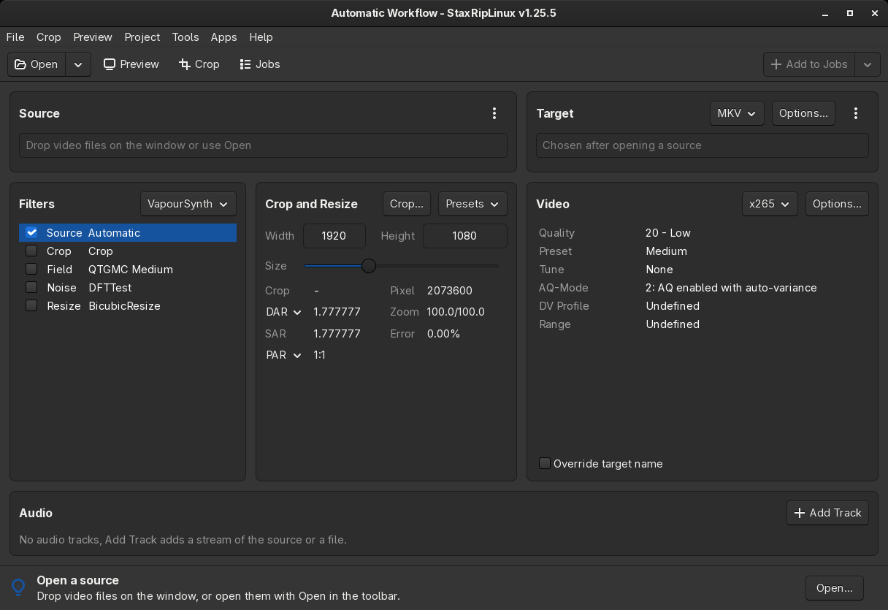
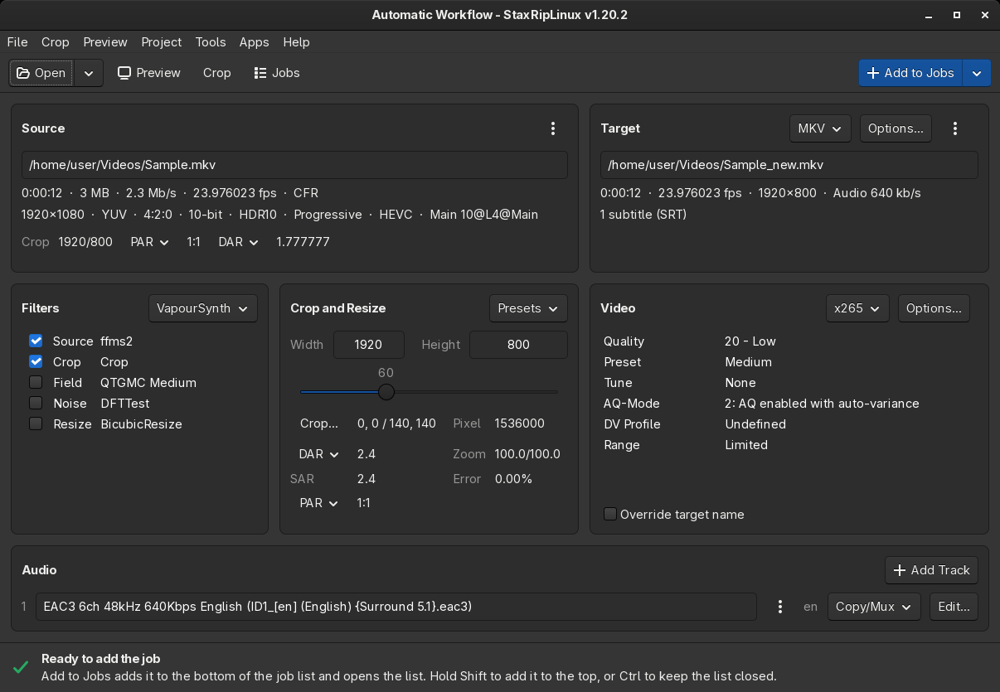
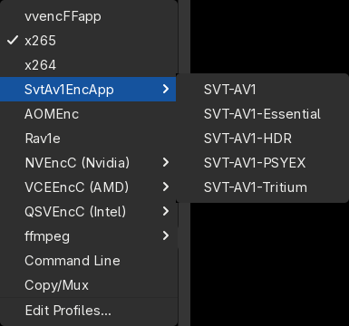
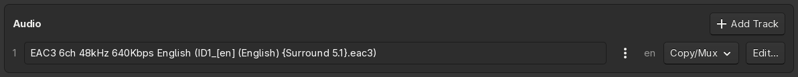
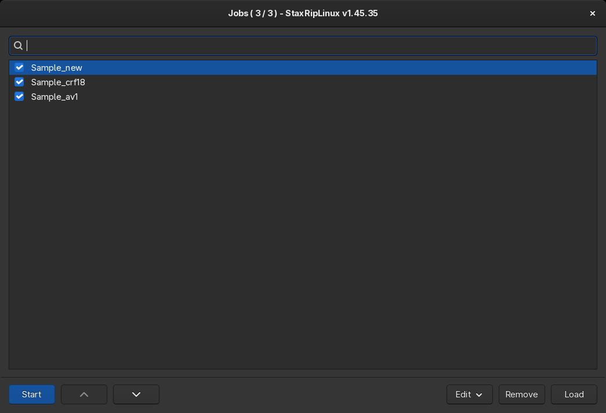
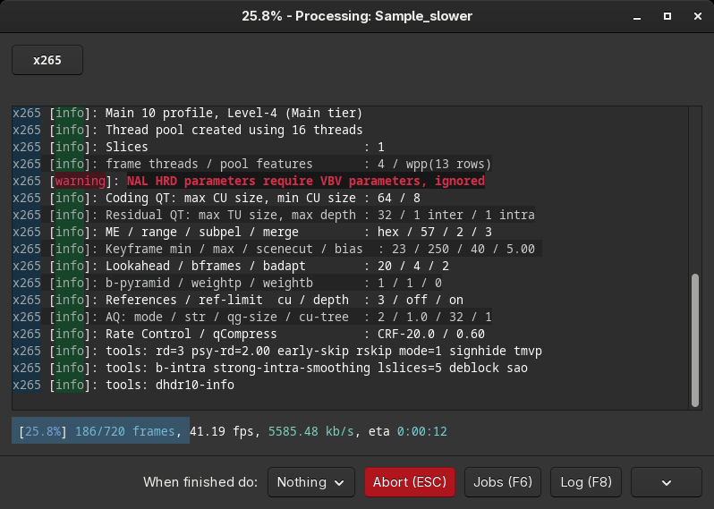

# [Documentation](../README.md) / [Guides](README.md) / First Time Encode

This guide encodes a video with x265 and keeps the audio, the subtitles and the chapters, a common task to make a
Blu-ray remux or a large recording smaller. It takes about ten minutes, plus the time of the encode.

## 1. Start StaxRipLinux

On the first start the *What's new* dialog lists the changes, `OK` closes it. The main window starts with the
*Automatic Workflow* template, which demuxes the audio tracks and subtitles of the preferred languages and chooses the
source filter by itself:

The bar at the bottom says what to do next: open a source.

## 2. Open the source

Click `Open` in the toolbar and choose the video, or drop it on the window. StaxRipLinux reads the source, demuxes its
tracks into a temp folder next to it, indexes the video and detects black borders. This takes a moment, longer for
large files:

The [Source](../Usage/User-Interface/Main.md#source) card shows the properties of the video: here a 1080p HDR10 video
with 23.976 frames per second. The [Target](../Usage/User-Interface/Main.md#target) card shows the target file, by
default next to the source with the same name, `_new` is appended when it would overwrite the source.

## 3. Check crop and filters

The [Filters](../Usage/User-Interface/Main.md#filters) card lists the script: the source filter, `Crop` and some
inactive filters. For a clean Blu-ray no other filter is needed. Check the crop values in the
[Crop](../Usage/User-Interface/Crop.md) window (`F3`): the colored borders should cover exactly the black bars. Then
look at the video in the [Preview](../Usage/User-Interface/Preview.md) (`F4`).

> [!TIP]
> For interlaced sources, like many DVDs and TV recordings, enable a deinterlacer like *QTGMC* in the `Field`
> category. The Source card shows whether a source is interlaced.

## 4. Choose the encoder and the quality

The [Video](../Usage/User-Interface/Main.md#video) card shows the encoder, x265 by default. Its most important setting
is the **Quality**: lower values give better quality and larger files. `20` is a good start for 1080p, `18` keeps
more detail, `22` to `24` give smaller files. The **Preset** trades speed for efficiency, `Slow` compresses better than
`Medium`, but takes about twice as long.

HDR10 metadata is taken over automatically. See [Video Encoders](Encoder/Video.md) for the other encoders.

## 5. Audio and subtitles

The [Audio](../Usage/User-Interface/Main.md#audio) card shows the demuxed tracks. `Copy/Mux` keeps a track as it is,
an encoder profile like `Opus` or `AAC` makes it smaller. Lossless tracks like TrueHD or DTS-HD MA are large, encoding
them to `EAC3 640 Kbps` or `Opus` saves a lot of space.

The subtitles and chapters are on the [Container Options](../Usage/User-Interface/Container-Options.md) of the Target
card, they're taken over by default.

## 6. Add the job and start it

When the bar at the bottom says that the job is ready, click `Add to Jobs`. The [Jobs](../Usage/User-Interface/Jobs.md)
window opens with the job, `Start` starts it:

The processing window shows the output of the encoder and the progress:

When the job is finished, the target file is next to the source. The [log
file](../Usage/User-Interface/Log-File-Viewer.md)
contains every step, if something went wrong it shows why.

## Next steps

- Save the setup as [template](../Usage/User-Interface/Save-Template.md), so the next sources start with it.
- Compare the encode with the source in the [Video Comparison](../Usage/User-Interface/Video-Comparison.md).
- Read about [video](General/Video.md) and [audio](General/Audio.md) basics and the
  [encoders](Encoder/Video.md).
