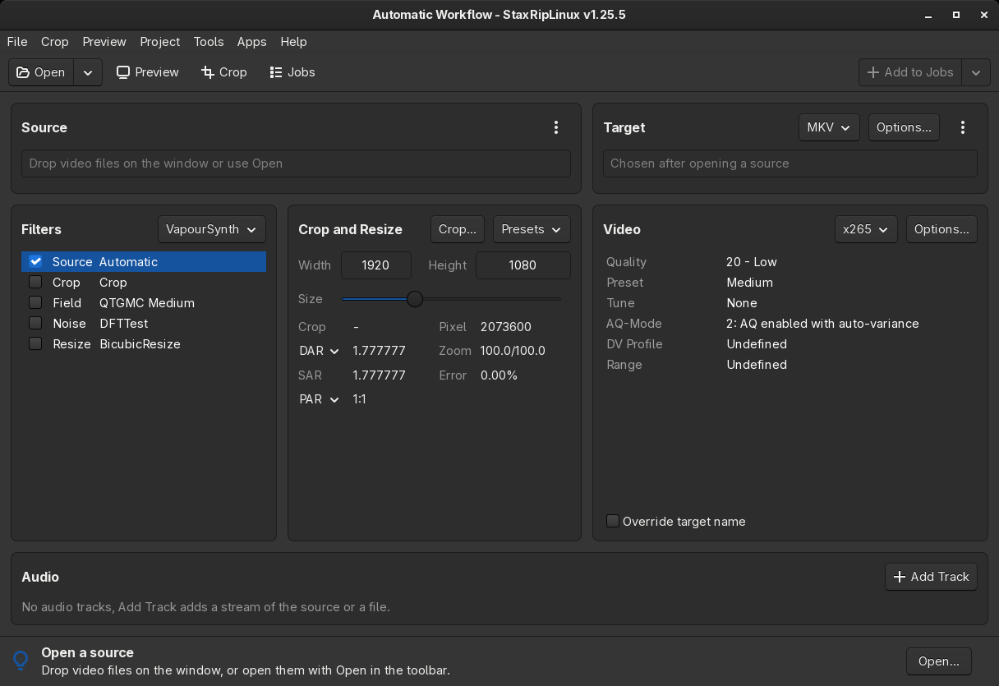
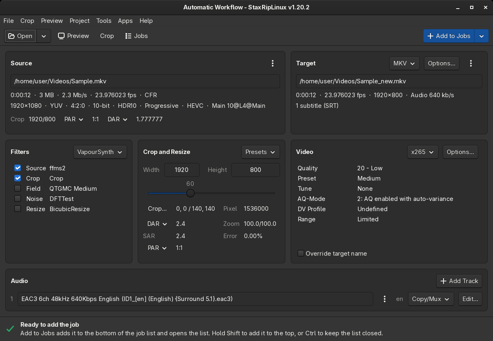
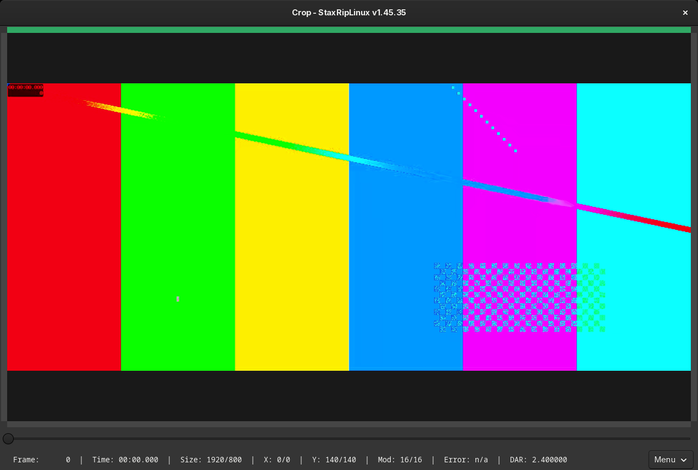
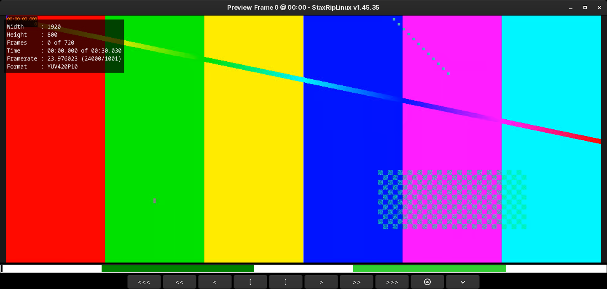
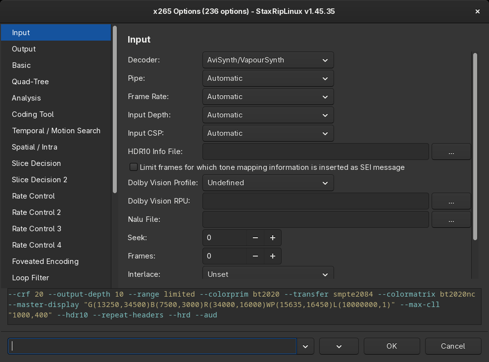
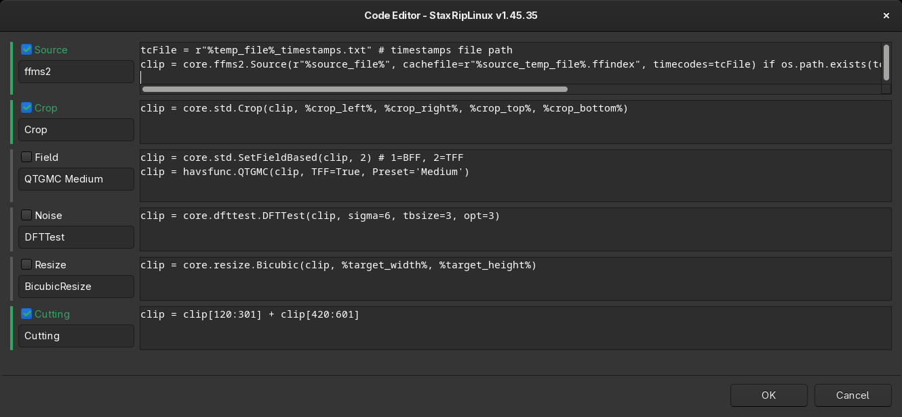
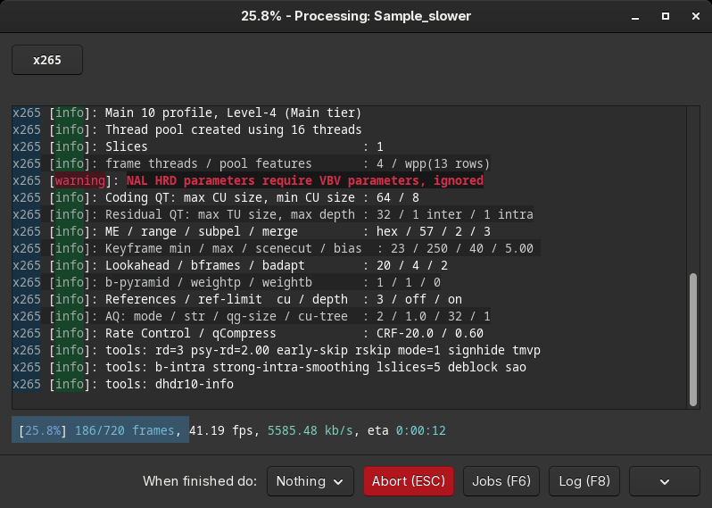
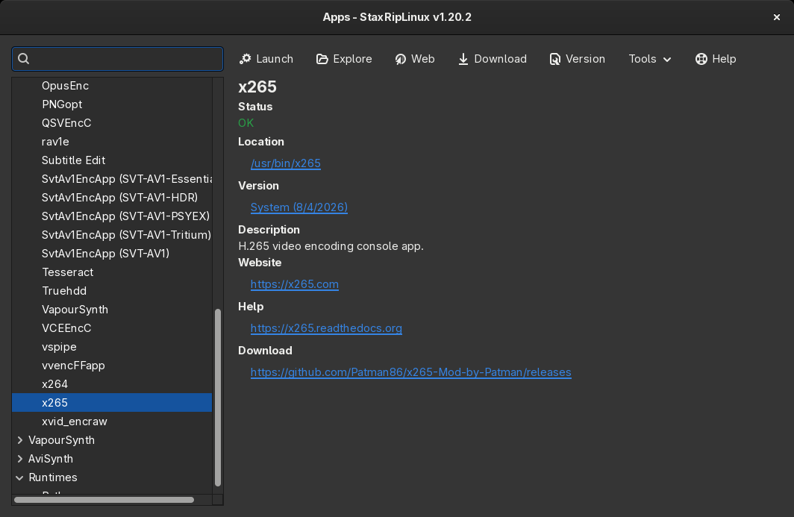
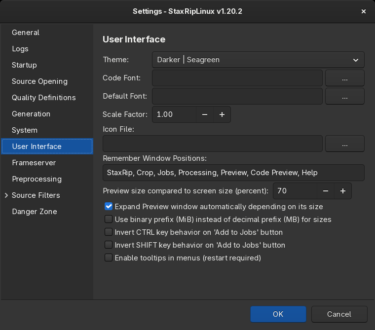
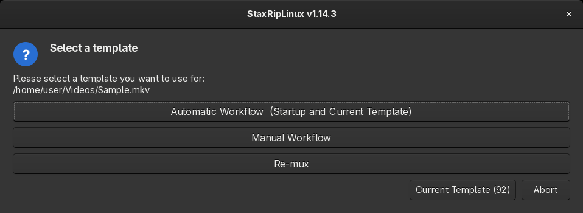

# [Documentation](../README.md) / [Introduction](README.md) / Screenshots

## Main Window

  
  

## Crop

  

## Preview and cutting

  

## Encoder Options

  

## Code Editor

  

## Processing

  

## Apps Manager

  

## Settings

  

## Template Selection

  
