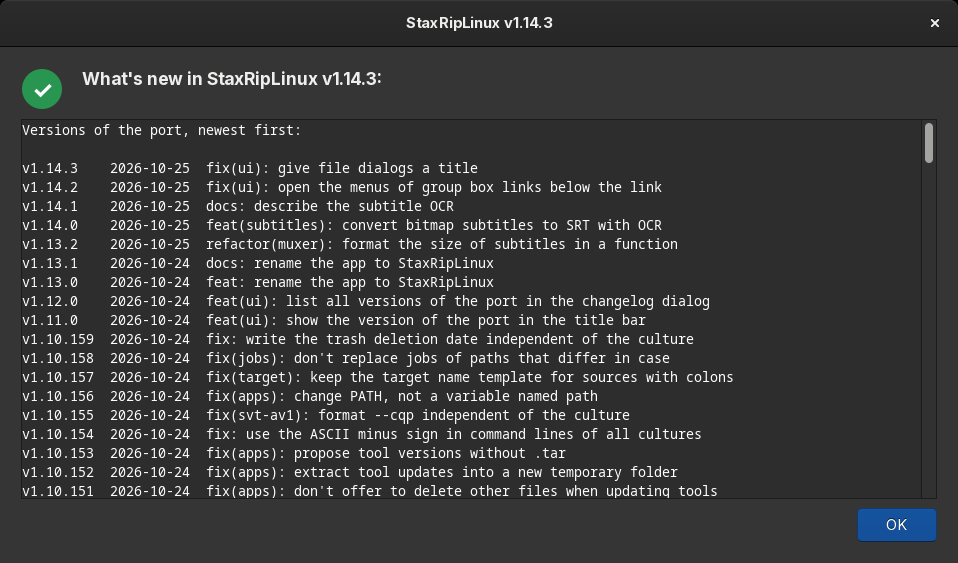
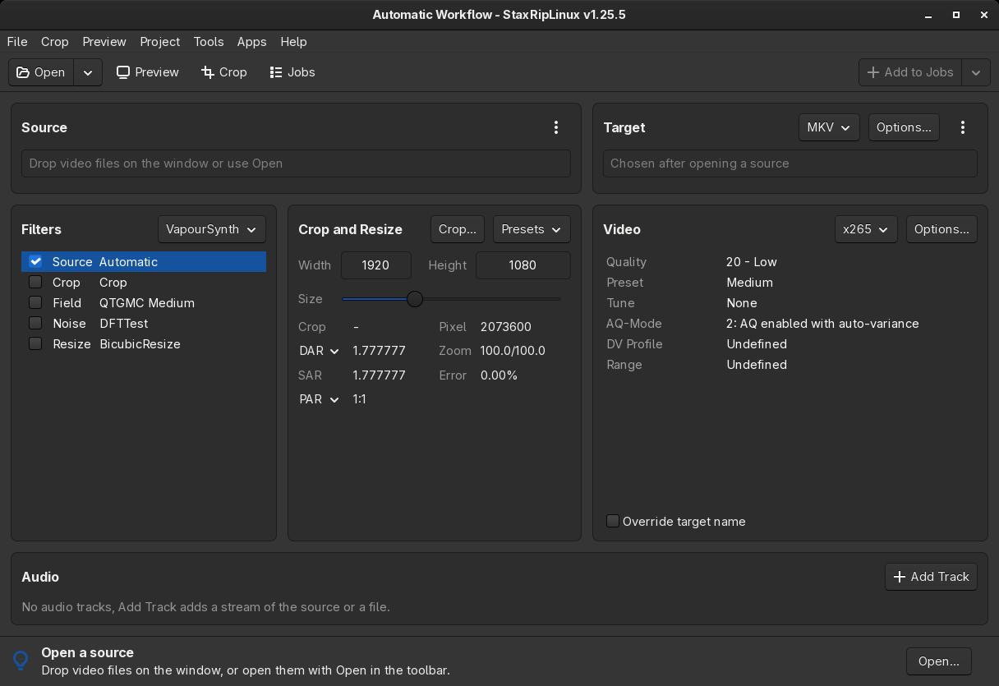

# [Documentation](../README.md) / [Usage](README.md) / First Start

## Installation
The full AppImage contains the tools StaxRipLinux works with, the slim AppImage and builds from source use the tools of
the system. Please make sure that you have followed the steps in [AppImage](../Introduction/Linux.md#appimage) or
[Installation](../Introduction/Linux.md#installation) and, without the full AppImage, installed the
[requirements](../Introduction/Linux.md#requirements).

## Settings Directory
StaxRipLinux stores data like settings, templates and the job list in `~/.config/StaxRip`
(`$XDG_CONFIG_HOME/StaxRip`) without asking. A folder next to the AppImage with its name and `.config` appended, like
`StaxRipLinux-<version>-x86_64.AppImage.config`, keeps the data next to the AppImage instead, so different versions can
run next to each other. For builds from source, a folder named `Settings` next to the `StaxRip` executable does the
same. The environment variable `STAXRIP_SETTINGS` overrides both, see
[Desktop integration](../Introduction/Linux.md#desktop-integration).

## What's New
On the first start the *What's New* dialog appears. It lists all versions of StaxRipLinux with their changes, newest
first, followed by the notes of the StaxRip release StaxRipLinux is based on. It appears again once after each update,
and *Help > What's new...* shows it any time:

## Let's go
Finally you will see the main window, which appears directly the next time you launch StaxRipLinux:

> [!TIP]
> For a better understanding of what you see, what you can use and most important *how*,
I recommend reading about the [Workflow](Workflow.md) and [User Interface](User-Interface/README.md).