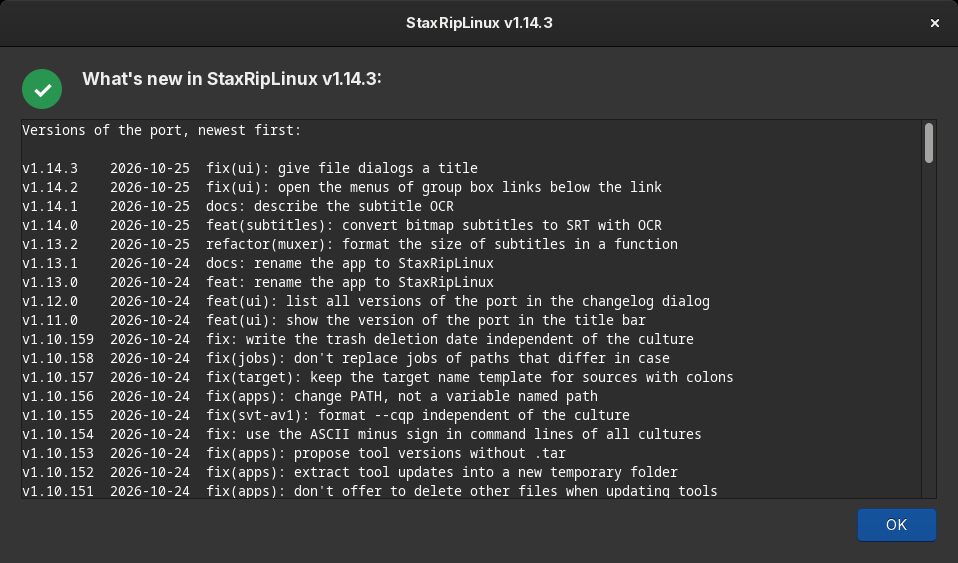
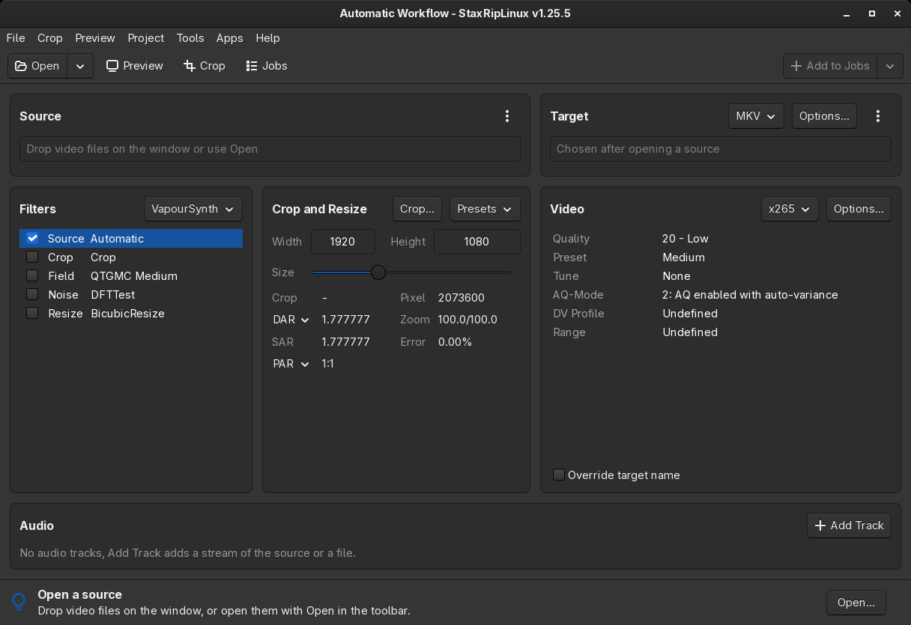

# [Documentation](../README.md) / [Usage](README.md) / First Start

## Installation
StaxRipLinux is written so it can run completely on its own. Nevertheless, some conditions must be met.
Please make sure, that you have followed all steps mentioned in [Installation](../Introduction/Installation.md).

## Settings Directory
When you start StaxRip for the first time a dialog appears, that asks you to chose a location for stored data
like settings, templates, job queue, fonts, etc.:

It is highly recommended to choose the first option. This keeps the stored data next to your instance and you can easily
run different StaxRip versions next to each other.

## Windows 7 Warning
After confirming with the `OK` button, **Windows 7** users will see a warning that let's you know, that 
***Windows 7 is not completely supported*** and that some tools have to be replaced or simply doesn't work.  
For more information: [System Requirements](../Introduction/System-Requirements.md) & [Installation](../Introduction/Installation.md)

## Long Path Support
StaxRip checks (on each startup, in not disabled), if **Long Path Support** is enabled on your system. In case it is not enabled,
a dialog will pop up and ask you, if you want to enable it, which you should accept with a click on `Yes`:

For more Information see: [Long Path Support](Long-Path-Support.md)

## What's New
After your decision the *What's New* dialog appears. It lists all versions of the Linux port with their changes, newest
first, followed by the notes of the StaxRip release the port is based on. It appears again once after each update, and
*Help > What's new...* shows it any time:

## Let's go
Finally you will see the main window, that you should see directly next time you launch StaxRipLinux
as all decisions have been made and stored:

> [!TIP]
> For a better understanding of what you see, what you can use and most important *how*,
I recommend reading about the [Workflow](Workflow.md) and [User Interface](User-Interface/README.md).