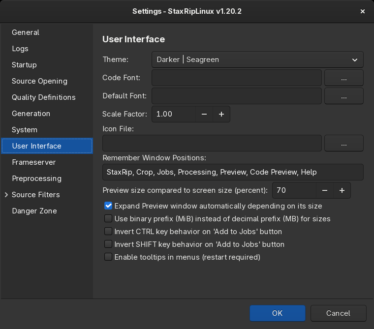

# [Documentation](../README.md) / [Usage](README.md) / Fonts

StaxRipLinux uses the fonts installed on the system. You can choose a font for default texts as well as a font for
code type presentations like encoder parameters and scripts. This gives you the possibility to improve the readability
and/or reduce the needed space by texts, so more text fits a desired space.  
To change them go to: `Tools » Settings » User Interface`:

Without a choice, the interface font of the desktop is used for texts and the monospace font of fontconfig for code.
The code fonts to choose from are only monospaced fonts. The font of thumbnail sheets is chosen in the thumbnail
options of the project (`Project » Options » Thumbnails`).

> [!TIP]
> To use other fonts, install them with the package manager or copy the font files to `~/.local/share/fonts`.
> StaxRipLinux lists new fonts after a restart.
