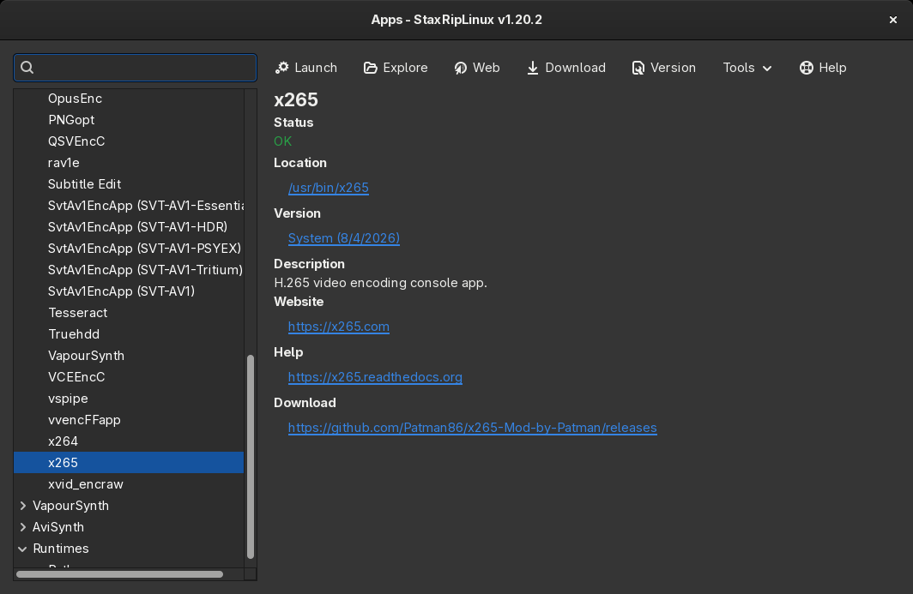

# [Documentation](../../README.md) / [Usage](../README.md) / [User Interface](README.md) / Apps Manager

`Apps > Manage...` (`F11`) opens the apps manager. It lists every tool, plugin and script StaxRipLinux works with,
shows whether it's found and where, and how to get it.

The tree on the left groups the apps by category, AviSynth and VapourSynth plugins and scripts are listed separately.
The search field filters the list by name, description, version, website, path and filter names, `<notfound>` lists
the apps that aren't found and `<newversion>` the apps whose version differs from the known one.

The right side shows the selected app:

- **Status**: whether the app is found and ready. If not, the reason and, for many apps, a button that shows how to
  install it.
- **Location**: the path of the app, a click opens its folder.
- **Version**: the version StaxRipLinux knows, a click confirms the version of a newer build.
- **AviSynth Filters**, **VapourSynth Filters**: the filters of a plugin, which StaxRipLinux uses to detect the plugins
  a script needs.
- **Description**, **Website**, **Help** and **Download**.

## Where the apps come from

The full AppImage contains most apps. The slim AppImage and builds from source use the apps installed on the system,
StaxRipLinux searches them in `PATH`, the library folders and the plugin folders, see
[How StaxRipLinux finds tools and plugins](../../Introduction/Linux.md#how-staxriplinux-finds-tools-and-plugins).
A custom path overrides both, for example to use another version of an encoder.

## Menu

The `Tools` menu at the top has the commands for the selected app:

| Entry | Key | Description |
|---|---|---|
| Edit Path... | `Ctrl+P` | Sets a custom path to the app |
| Find Path... | `Ctrl+F` | Searches the app in the file system |
| Clear Paths... | `Ctrl+X` | Removes custom paths |
| Copy Path | | Copies the path of the app |
| PATH Env Var... | | Adds the folder of the app to the `PATH` of the processes StaxRipLinux starts, or removes it |
| Edit Version | `F12` | Confirms the version of the app, for a build StaxRipLinux doesn't know |
| Show Grid | `Ctrl+G` | Shows all apps as CSV table in the default application for CSV files |
| Check All | `Ctrl+S` | Checks the status of all apps |
| Check Required Only | `Ctrl+Y` | Checks the status of the apps the current project needs |
| Download | `Ctrl+D` | Opens the download page |
| Website | `Ctrl+W` | Opens the website |
| Explore | `Ctrl+E` | Opens the folder of the app in the file manager |
| Launch | `Ctrl+L` | Starts the app, console apps show their help in a terminal |
| Help | `F1` | Opens the help of the app |

> [!NOTE]
> StaxRipLinux knows the version of every app it was tested with. When a newer build is found, it asks once whether to
> use it, `Edit Version` confirms it as well. Apps found in `PATH` are trusted without asking, because the package
> manager updates them. The confirmed versions are stored in the `Conf` folder of the settings.
