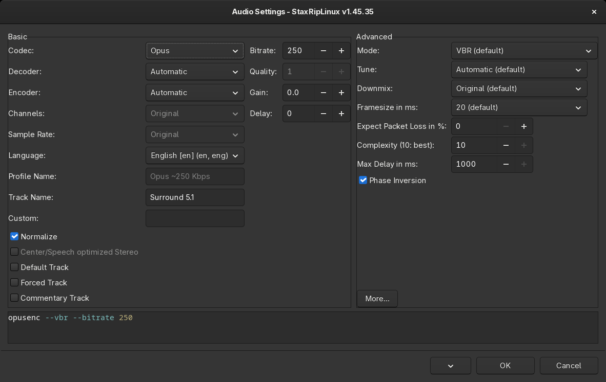

# [Documentation](../../README.md) / [Usage](../README.md) / [User Interface](README.md) / Audio Settings

`Edit...` of an audio track on the [Audio](Main.md#audio) card opens its settings. The audio profile of the track
decides what happens with it:

- an **encoder profile**, like `AAC`, `AC3` or `Opus`, encodes the track with this dialog's settings,
- **Copy/Mux** copies the track without encoding,
- **Command Line** encodes it with a custom command line,
- **No Audio** leaves the track out.

## Basic

- **Codec**: AAC, AC3, AC4, EAC3, DTS, FLAC, MP3, Opus, Vorbis, W64 or WAV.
- **Encoder**: the tool that encodes the codec, `Automatic` chooses one:

  | Codec | Encoders |
  |---|---|
  | AAC | fdkaac, ffmpeg, eac3to |
  | AC3 | ffmpeg, DeeZy (DEE), eac3to |
  | AC4 | DeeZy (DEE) |
  | EAC3 | ffmpeg, DeeZy (DEE) |
  | DTS | eac3to |
  | FLAC | ffmpeg, eac3to |
  | MP3, Vorbis | ffmpeg |
  | Opus | opusenc, ffmpeg |
  | W64, WAV | ffmpeg, eac3to |

  With `Automatic`, AAC uses fdkaac if it's installed, otherwise the AAC encoder of FFmpeg.
- **Decoder**: which tool decodes the source for encoders that can't read it, and forces decoding even when it isn't
  necessary.
- **Channels** and **Sampling Rate**: `Original` keeps them, fewer channels downmix the audio.
- **Bitrate** and **Quality**: the bitrate, or the quality for encoders with a quality mode, like the VBR mode of
  fdkaac or Opus.
- **Gain**: changes the volume in dB.
- **Delay**: the delay in milliseconds, read from the file name of demuxed tracks (`DELAY 40ms`). It's applied by the
  muxer.
- **Language**: the language of the track in the target. The language and the delay are saved in projects and
  templates, not in profiles.
- **Profile Name**: the name of the profile, generated automatically when it's empty.
- **Stream Name**: the name of the track in the target, may contain [macros](../Macros.md).
- **Custom**: additional command line arguments for the encoder.
- **Normalize**: normalizes the volume. The method, peak volume (`volumedetect`), EBU R128 loudness (`loudnorm`) or
  dynamic normalization (`dynaudnorm`), is chosen in the advanced options of ffmpeg.
- **Center/Speech optimized Stereo**: a stereo downmix that keeps dialogues clear.
- **Default Track**, **Forced Track**, **Commentary Track**: the flags of the track in MKV files.

## Advanced

The right side shows the options of the encoder, for example the rate mode, tune, frame size and complexity of
opusenc, the AAC profile (LC, HE-AAC) and VBR mode of fdkaac, or the dynamic range compression and stereo downmix of
eac3to and DeeZy. `More...` opens further options: the *Decoding Method*, the ffmpeg options like the
*Normalize Method*, and the settings of the `loudnorm` and `dynaudnorm` normalization.

The command line at the bottom shows how the encoder is run. The menu button has *Execute Command Line*,
*Copy Command Line*, *Show Command Line...*, *Save Profile...*, which saves the settings as new audio profile, and the
help of eac3to and ffmpeg.

The audio profiles of the menu on the Audio card are edited with `Edit Profiles...` in that menu.
