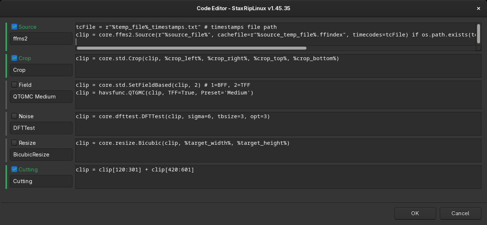

# [Documentation](../../README.md) / [Usage](../README.md) / [User Interface](README.md) / Code Editor

The code editor shows the code of all filters of the script, one box per filter, and lets you change it. It opens with
a double-click on the [filters](Main.md#filters) list or with `Edit Code` in the filter menu.

Each filter has a checkbox with its category, which enables or disables it, the name and the code. The code is
AviSynth+ or VapourSynth code, depending on the [frame server](../Frame-Servers.md), and may contain
[macros](../Macros.md). `OK` applies the changes, the main window shows the filters with their new names.

## Menu

A right-click on the code of a filter opens the menu:

| Entry | Key | Description |
|---|---|---|
| *Category* | | The other filter profiles of the category of this filter, to replace it |
| Replace, Insert, Add | | Replace this filter, insert a filter before it or add one at the end, from the filter profiles |
| Apply all Filters | `Ctrl+S` | Applies the changes without closing the editor |
| Preview Video... | `F6` | Opens the [Preview](Preview.md) with the current code |
| Preview Code... | `F4` | Shows the complete script with all macros resolved |
| Play | `F9` | Plays the script with mpv |
| Info... | `F2` | Shows the size, frame rate, length and color format of the output |
| Advanced Info... | `Ctrl+F2` | Shows more information and benchmarks the script, see *Script Info* in the [main menu](Main.md#project) |
| Join... | `Ctrl+J`, `Ctrl+Alt+J`, `Ctrl+Shift+J` | Joins all, the active or the inactive filters into one, except source, crop, cutting, resize and rotation |
| Profiles... | `Ctrl+P` | Edits the [filter profiles](Filter-Profiles.md) |
| Macros... | `Ctrl+M` | Lists the macros, to insert them |
| Move Up, Move Down | `Ctrl+Up`, `Ctrl+Down` | Changes the order of the filters |
| Remove | `Ctrl+Delete` | Removes the filter |
| Cut, Copy, Paste | | Edits the text |
| Edit Menu... | | Customizes the menu, see [Menu Editor](Menu-Editor.md) |

Errors of the script are shown when the editor is closed with `OK` or a preview is opened, so they can be fixed right
away. `F1` shows the help with all keys.

> [!TIP]
> A filter that isn't in the filter profiles can be added with *Add* and the `Misc > Empty Filter` profile, then the
> code is written in the code editor. To keep a filter for later use, add it to the
> [filter profiles](../Filter-Profiles.md).
