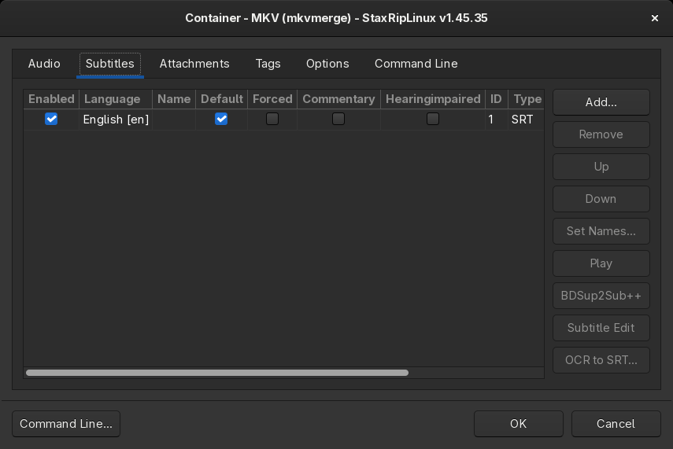
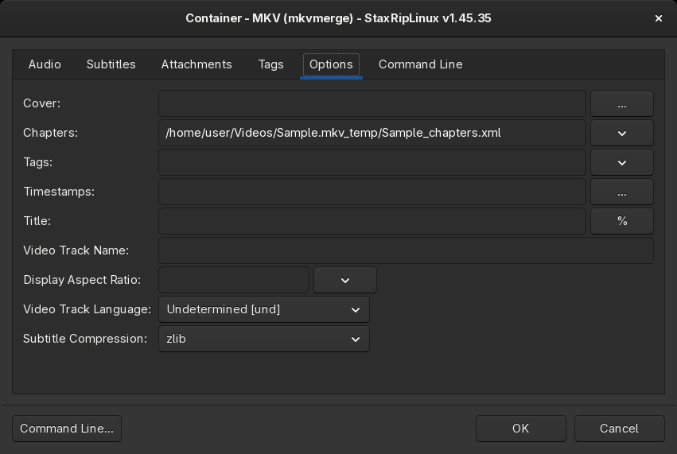

# [Documentation](../../README.md) / [Usage](../README.md) / [User Interface](README.md) / Container Options

`Options...` on the [Target](Main.md#target) card opens the options of the container, which combine the encoded video
with the audio tracks, subtitles, chapters and attachments into the target file. The container is chosen with the
button next to it: MKV and WebM are muxed with mkvmerge, MP4 with MP4Box, and the ffmpeg profiles cover many other
containers like MOV, TS, AVI or MXF.

## Audio

The audio tracks of the target, besides the tracks of the [Audio](Main.md#audio) card. Additional audio files are
added with `Add...`, which asks for the audio profile, for example `Copy/Mux` to add them without encoding. `Edit...`
opens the [Audio Settings](Audio-Settings.md) of the selected track, `Play` plays it with mpv.

## Subtitles

The subtitles of the target with their settings:

- **Enabled**: whether the subtitle is muxed.
- **Language** and **Name**: the language and the track name.
- **Default** and **Forced**: the flags that tell players which subtitle to show. Forced subtitles are shown even
  when subtitles are turned off, for example for foreign language dialogues.
- **Commentary** and **Hearingimpaired**: further flags of MKV.

`Add...` adds subtitle files, `Set Names...` sets the names of all subtitles from their language, `Play` plays the
video with the subtitle in mpv. `BDSup2Sub++` and `Subtitle Edit` open the subtitle in these apps, if they're
installed. `OCR to SRT...` converts the selected bitmap subtitle (PGS, VobSub) to a text subtitle with Tesseract,
see [Subtitle OCR](../../Introduction/Linux.md#subtitle-ocr).

Which subtitles of the source are added is set in the [Project Options](Project-Options.md#subtitles).

## Attachments

Files that are attached to MKV files, usually the fonts of ASS subtitles or a cover image. `Add...` adds files.

## Tags

Tags of MKV files, a name and a value per row, for example the title of a show and its season.

## Options

The options depend on the container. For MKV:

- **Cover**: an image that is attached as cover.
- **Chapters**: a chapter file (`.txt` or `.xml`), by default the chapters of the source.
  `Edit with chapterEditor...` opens it in chapterEditor if it's installed.
- **Tags**: a tag file (`.xml`).
- **Timestamps**: a timestamps file (`.txt`) or an MKV file whose timestamps are used, for variable frame rate videos.
- **Title**: the title of the file, may contain [macros](../Macros.md).
- **Video Track Name** and **Video Track Language**.
- **Display Aspect Ratio**: an aspect ratio applied by mkvmerge. It's better to signal the aspect ratio to the
  encoder, which StaxRipLinux does by default.
- **Subtitle Compression**: the compression of subtitle tracks.

MP4 has the chapters, the video track name and the pixel aspect ratio applied by MP4Box.

## Command Line

Additional command line switches for the muxer, which may contain macros. `Command Line...` at the bottom shows the
complete command line.
