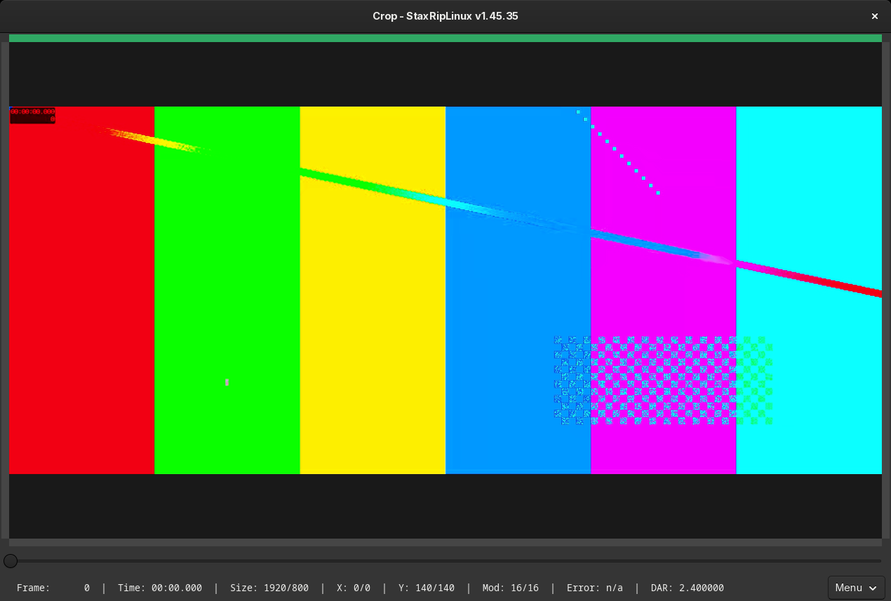

# [Documentation](../../README.md) / [Usage](../README.md) / [User Interface](README.md) / Crop

`Crop` in the toolbar or the main menu (`F3`) opens the crop window. It shows the source with the crop values as
colored borders, so you can check them and correct them. When a source is opened, StaxRipLinux usually detects the
crop values with [Auto Crop](../Cropping.md#auto-crop) already.

The status line shows the frame, its time, the size after cropping, the cropped pixels left/right (`X`) and top/bottom
(`Y`), the mod of the size, the aspect ratio error and the display aspect ratio. The slider below the video seeks.

## Cropping with the mouse and keyboard

The side next to the mouse pointer is the active side and gets highlighted.

- Drag with the left mouse button to set the active side to the pointer position.
- The mouse wheel crops the active side by 2 pixels, with `Shift` by 8 pixels, with `Ctrl` also the opposite side.
- `+` and `-` crop the active side by 2 pixels, `Shift` makes it 8 pixels and `Ctrl` includes the opposite side.

Cropped values are corrected to values the color format supports, 4:2:0 videos can only be cropped by even values,
unless *Auto correct crop values* is disabled in the [Project Options](Project-Options.md#crop).

## Menu

A right-click on the video or the menu button opens the menu:

| Entry | Key | Description |
|---|---|---|
| No Crop | `N` | Removes all crop values |
| Auto Crop | `A` | Detects the black borders, see [Auto Crop](../Cropping.md#auto-crop) |
| Smart Crop | `S` | Crops further until the aspect ratio error is as small as possible |
| Increase/Decrease Active Side | `+`/`-` | With `Shift` by 8 pixels, with `Ctrl` with the opposite side |
| Navigation | `F`, `T`, `PageUp`, `PageDown`, `Ctrl+Left`, `Ctrl+Right` | Go to a frame or time, 100 or 1000 frames back and forward (with `Ctrl`), start and end |
| Crop Color | | The color of the borders: the theme color, white, black or light gray |
| Crop Options... | `O` | The crop pages of the [Project Options](Project-Options.md#crop) |
| Edit Menu... | `M` | Customizes this menu and its keys, see [Menu Editor](Menu-Editor.md) |
| Help... | `F1` | Shows the help with all keys |
| Exit | `Escape` | Closes the window |

HDR sources are tonemapped for the crop window and dark scenes can be brightened, so the borders are easier to see, see
*Tonemapping for HDR videos* and *High contrast for easier cropping* in the [Project Options](Project-Options.md#crop).
This only affects the crop window, not the encode.
