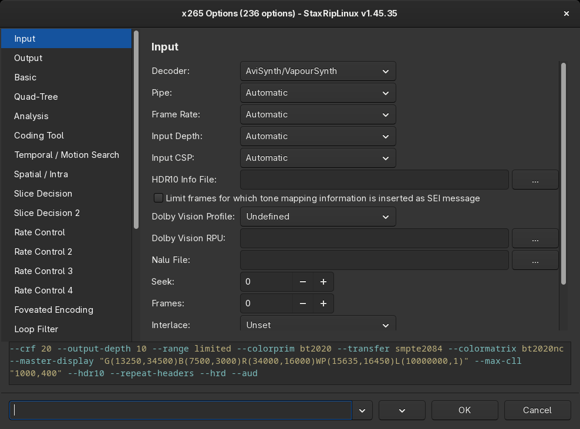

# [Documentation](../../README.md) / [Usage](../README.md) / [User Interface](README.md) / Encoder Options

`Options...` on the [Video](Main.md#video) card opens the options of the video encoder. The encoders that run as
console apps, like x264, x265, SvtAv1EncApp, aomenc, rav1e, vvencFFapp, NVEncC, QSVEncC, VCEEncC and ffmpeg, have a
dialog with all their options:

- The pages on the left group the options like the documentation of the encoder, for example *Basic*, *Rate Control*
  and *Analysis* for x265.
- The command line at the bottom shows the options as the encoder gets them. Options that differ from the defaults of
  the encoder are added, all others are left out.
- A right-click on a label, a dropdown or a checkbox shows the help of the option, taken from the help of the encoder.
- A double-click on a label resets the option to its default.
- The *Search* field at the bottom left finds options by their name or command line switch, `Enter` cycles through
  the matches.
- A click on a switch in the command line jumps to its control, if *Preview Mouse-Up Search* is enabled in the menu.

The options apply to the current project. To keep them for other projects, save a [template](Save-Template.md) or
an encoder profile with *Save Profile...*.

## Menu

The menu button at the bottom has:

| Entry | Key | Description |
|---|---|---|
| Execute Command Line | `Ctrl+E` | Runs the encoder with the current options and the script in a terminal, for a quick test |
| Copy Command Line | `Ctrl+Shift+C` | Copies the command line |
| Show Command Line... | `F4` | Shows the complete command line, including the input and output |
| Import Command Line... | `Ctrl+I` | Sets the options from a command line in the clipboard |
| Command Line Highlighting | `Ctrl+H` | Colors the switches and values of the command line |
| Preview Mouse-Up Search | `Ctrl+P` | A click on the command line jumps to the option |
| Save Profile... | `Ctrl+S` | Saves the options as new encoder profile |
| Help | `F1` | Help about the dialog and the encoder, `Ctrl+F1` the console help of the encoder |

## Common options

Besides the options of the encoder, the first pages contain options of StaxRipLinux:

- **Decoder** and **Pipe**: how the encoder gets the video. By default the script is piped to the encoder by vspipe
  (VapourSynth) or avs2yuv (AviSynth+), `ffmpeg` uses FFmpeg instead. Other decoders read the source directly with
  hardware decoding, which skips the filters.
- **Quality** or **Bitrate**: the rate control. Quality based modes (CRF, CQP) are the usual choice, see
  [Video Encoding](../../Guides/General/Video.md#rate-control).

### Chunks

x264, x265, aomenc, SvtAv1EncApp and its forks and vvencFFapp can split the video into chunks and encode them in
parallel, which uses CPUs with many cores better. **Chunks** sets the number of chunks, the
[Settings](Settings.md#general) limit the parallel processes. The chunks are joined before muxing. With x265 and
the SvtAv1EncApp forks every chunk gets the Dolby Vision and HDR10+ metadata of its frames.

### Compressibility Check

x264, x265, aomenc, rav1e, SvtAv1EncApp and its forks and vvencFFapp can run a compressibility check when they encode
with a bitrate: StaxRipLinux encodes parts of the video with the quality value **Comp. Check** and compares the result
with **Aimed Quality** to estimate the bitrate the video needs. The result adjusts the target size or the image size,
see *After comp. check adjust* in the [Project Options](Project-Options.md#misc). `Project > Options > Misc` can run
it automatically after opening a source.

### Override target name

*Override target name* on the Video card names the target file after the encoder options, using the encoder macros
like `%--preset%` or `%--crf%`, see [Encoder Macros](../Macros.md#encoder-macros). A right-click on the checkbox opens
this
option in the encoder options.

## HDR

When a source has HDR10 metadata, *Import VUI metadata* in the [Project Options](Project-Options.md#video) passes the
color information and the mastering display and light level metadata to the encoder. x265, SvtAv1EncApp and its forks,
NVEncC, QSVEncC and VCEEncC also get the dynamic metadata:

- **HDR10+**: the metadata is extracted with hdr10plus_tool and passed to the encoder.
- **Dolby Vision**: the RPU metadata is extracted with dovi_tool, its crop values are updated when the video is
  cropped, and it's passed to the encoder with the profile set in the encoder options, usually 8.1. The encoder needs a
  build with Dolby Vision support, for SvtAv1EncApp see [Tools](../../Introduction/Linux.md#tools).
- **Dolby Vision from HDR10+**: *Generate Dolby Vision from HDR10+* in the [Project Options](Project-Options.md#video)
  generates the RPU from the HDR10+ metadata when the source has no Dolby Vision metadata.

## Other encoders

- **Command Line** runs any encoder with a command line that may contain [macros](../Macros.md), for encoders that
  aren't built in.
- **Copy/Mux** doesn't encode, the video stream of the source is copied into the target.

The encoder profiles of the menu on the Video card are edited with `Edit Profiles...`, which can rename, copy, remove
and order them.
