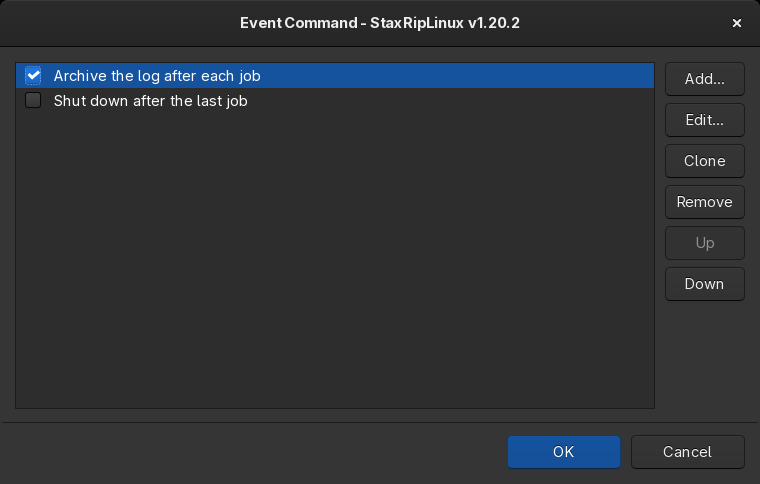
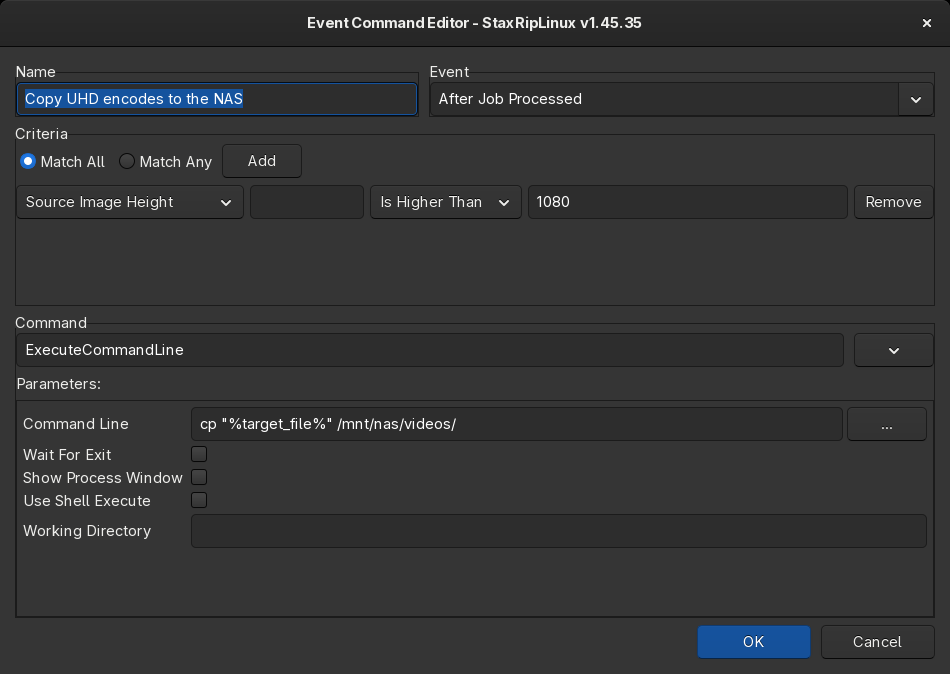

# [Documentation](../../README.md) / [Usage](../README.md) / [User Interface](README.md) / Events

`Tools > Advanced > Event Commands...` (`Ctrl+E`) opens the list of event commands. An event command runs a
[command](../Commands.md) when something happens, for example after a job is processed. See [Events](../Events.md) for
the events and examples.

The checkbox of an event command enables or disables it. `Add...` creates a new one, `Edit...` changes the selected
one, `Clone` copies it, `Remove` removes it, `Up` and `Down` change the order in which event commands of the same
event run.

## Event Command editor

- **Name**: the name in the list.
- **Event**: when the command runs.
- **Criteria**: optional conditions, the command only runs when they're met. `Match All` requires all conditions,
  `Match Any` one of them. Each condition compares a [macro](../Macros.md) with a value, for example
  `%source_height%` *Is Higher Than* `1080`, or `%target_file%` *Contains* `.mkv`.
- **Command** and **Parameters**: the command and its parameters, like in the [Menu Editor](Menu-Editor.md).
