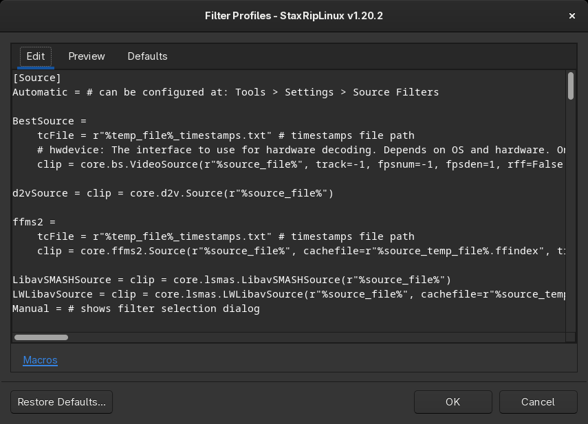

# [Documentation](../../README.md) / [Usage](../README.md) / [User Interface](README.md) / Filter Profiles

The filter profiles are the filters the filter menus offer. `Profiles` in the menu of the [filters](Main.md#filters)
opens them for the current [frame server](../Frame-Servers.md), AviSynth+ and VapourSynth have their own profiles.

The left side contains the profiles as text, the right side the defaults for comparison. `Restore Defaults...`
replaces your profiles with the defaults, for example after an update that added filters. The `Source`, `Crop` and
`Resize` categories are required, StaxRipLinux recreates them if they're missing. The format of the profiles is
described in [Filter Profiles](../Filter-Profiles.md).

The find field above the text (`Ctrl+F`) searches the profiles, `Enter` or `F3` finds the next match and
`Shift+Enter` or `Shift+F3` the previous one. The editors of command lines, event commands and variables have the same
field.

The filter setups, which are complete scripts with several filters, are edited with `Filter Setup > Edit Profiles` in
the same menu:

