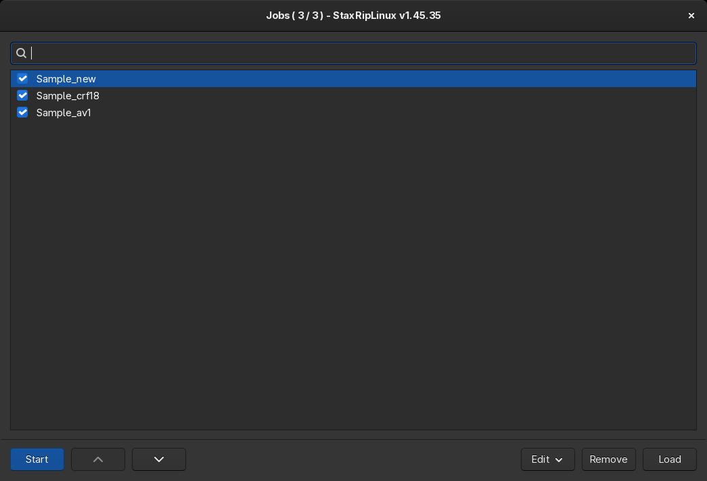
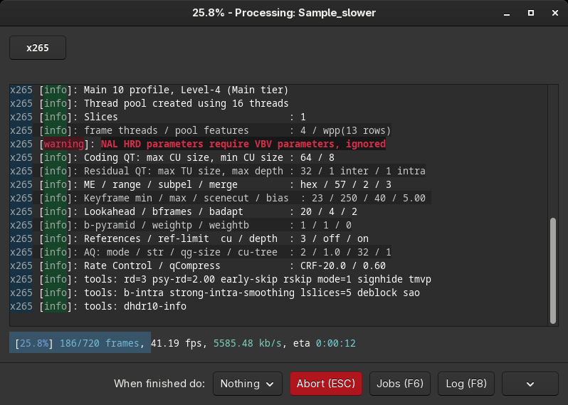

# [Documentation](../../README.md) / [Usage](../README.md) / [User Interface](README.md) / Jobs

`Jobs` in the toolbar or `Tools > Jobs` (`F6`) opens the job list. [Add to Jobs](Main.md#add-to-jobs) adds the
current project to it, *File Batch* adds a job for each file, see [Opening](Opening.md#ways-to-open-a-source).

Every job is a saved project. The checked jobs are processed from the top when `Start` is pressed, unchecked jobs are
skipped. Jobs can be moved by drag & drop and with the arrow buttons, `Remove` removes the selected jobs and `Load`
opens the project of a job in the main window, for example to change it. The search field filters the jobs by name,
`<active>` shows only the checked jobs, the filter doesn't change the order in which the jobs are processed.

The `Edit` menu has the commands for the selection:

| Entry | Key |
|---|---|
| Select All, Select None | `Ctrl+S`, `Shift+S` |
| Check Selection, Check All | `Shift+C`, `Ctrl+C` |
| Uncheck Selection, Uncheck All | `Shift+U`, `Ctrl+U` |
| Move Selection Up, Down | `Ctrl+Up`, `Ctrl+Down` |
| Move Selection To Top, Bottom | `Ctrl+Home`, `Ctrl+End` |
| Sort Alphabetically | `Ctrl+Shift+S` |
| Remove Selection | `Delete` |
| Load Selection | `Ctrl+L` |

`Space` checks or unchecks the selected jobs.

The job list is stored in the settings folder (`Jobs.dat`) and shared by all instances of StaxRipLinux. Several
instances can process the list at the same time: a job is unchecked when its processing starts, so every instance
takes the next checked job. This uses CPUs with many cores better. `File > Launch New Instance` starts another instance.

## Processing

While the jobs are processed, the processing window shows the output of the running tools:

When audio and video are processed in parallel, there is a button for each process at the top to switch between their
outputs. The bottom line shows the progress of the current process.

- **When finished do**: what happens after the last job: `Nothing`, `Close` StaxRipLinux, `Standby`, `Hibernate`,
  `Hybrid` or `Shutdown`. Standby and shutdown use `systemctl` or `loginctl`, the
  [Settings](Settings.md#system) set the timeout before the shutdown.
- **Abort** (`Escape`) aborts the job processing of this instance.
- **Jobs** (`F6`) opens the job list, **Log** (`F8`) the log file.
- The menu button has:
    - **Suspend** and **Resume** to pause the current process, which doesn't work with all tools,
    - **Priority** to change the priority of the running process,
    - **Skip**, which aborts the current job and continues with the next one,
    - **Stop After Current Job**,
    - **Output Highlighting** and **Progress Reformatting** (`Ctrl+O`, `Ctrl+P`), which make the output easier to
      read, **Progress Highlighting** and **Temporary Theme**.

The processing window can be minimized to the tray, see [Settings](Settings.md#system). While jobs are processed, the
system doesn't enter standby, unless *Prevent system from entering standby mode while encoding* is disabled.

When a job fails, the error is shown for the time set in the [Settings](Settings.md#general) and the next job starts.
The log file of the job contains the details, see [Log File Viewer](Log-File-Viewer.md).
