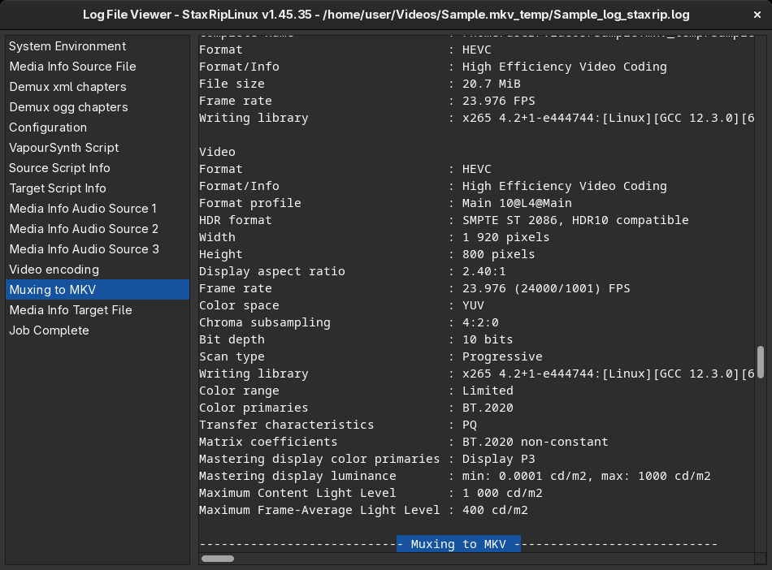

# [Documentation](../../README.md) / [Usage](../README.md) / [User Interface](README.md) / Log File Viewer

StaxRipLinux logs every step of a project: the media info of the source, the scripts, the command lines of all tools
with their output, and the errors. `Project > Log File` opens the log of the current project in the log file viewer:

The list on the left contains the sections of the log, a click jumps to it. The log is saved in the temp folder of the
project as `<target name>_staxrip.log`, and after each job a copy goes to `Tools > Folders > Log Files`, see
[Settings](Settings.md#logs).

A right-click on the log opens the menu:

- **Save As...** saves a copy of the log.
- **Save Obfuscated As...** (`Ctrl+Alt+S`) saves a copy in which the path and name of the source are replaced, which is
  safer to attach to a bug report. Other paths, scripts and command lines can still contain personal information, so
  check the file before you share it.
- **Open in Text Editor** (`Ctrl+T`) opens the log with the default text editor.
- **Show in File Manager** (`Ctrl+E`) shows the log file in the file manager.
- **Show History** (`Ctrl+H`) opens the folder with the logs of the previous jobs.

> [!TIP]
> When a job fails, the log shows the command line of the tool that failed and its output. Running this command line in
> a terminal often shows the problem directly. Please attach the log when you
> [report a bug](https://github.com/SwiftFly78/staxripLinux/issues).
