# [Documentation](../../README.md) / [Usage](../README.md) / [User Interface](README.md) / Main Window

- [Main Menu](Main.md#main-menu)
- [Toolbar](Main.md#toolbar)
- [Source](Main.md#source)
- [Target](Main.md#target)
- [Filters](Main.md#filters)
- [Crop and Resize](Main.md#crop-and-resize)
- [Video](Main.md#video)
- [Audio](Main.md#audio)
- [Next Step](Main.md#next-step)

-----

When you start StaxRipLinux, you will see the main window - on your very [first start](../First-Start.md) there
will appear some dialogs beforehand, but you will also end up on the main window:

  

The main window shows the whole encode at once: the toolbar at the top, below it a card for each part of the encode
and at the bottom the next step. Every card has its menus and options as buttons next to its heading.
Let's look at each part and see, what we can find there:

## Main Menu

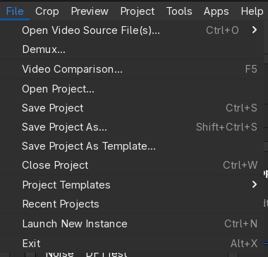  

### File
- #### Open Video Source File(s)
	Opens a dialog, that gives you the opportunity to open a source file in different ways.  
    For more information check out [Open Video Source File(s)](Opening.md).
- #### Demux
	Demuxes a video file into a specific folder while referring to the [Project Options](Project-Options.md).
- #### Video Comparison
	It's a feature to compare different versions of a video, for example a source and an encode or just a
    AviSynth or VapourSynth script with some filters, that were applied, in order to see and compare the effects.  
    For more information check out [Video Comparison](Video-Comparison.md).
- #### Open Project
	Opens an existing project.
- #### Save Project
	Saves and overwrites the current project.
- #### Save Project As...
	Opens a dialog to let you choose the location and file name of the current project, that is about to be saved.
- #### Save Project As Template
	In case there is no source file loaded yet, you can save the current project as a template,
    so it can be used later again. 
    For more information check out [Save Template](Save-Template.md).
- #### Close Project
	This command closes the current project/template and loads the startup template again.
- #### Project Templates
	The expanding list contains all templates, that are available.
	Subfolders in the Templates folder are represented by submenus.
	Choose one and click on it to load it.
- #### Recent Projects
	Currently the last up to 25 projects, that you have used, are listed here. This gives you the opportunity
	to quickly re-load such a project.  
	The number of listed projects can be adjusted in [Settings](Settings.md#user-interface).
- #### Launch New Instance
	Simply starts a new StaxRipLinux instance.
- #### Exit
	It feels weird to explain this, but it closes StaxRipLinux. :astonished:
	In case the project has not been saved and projects are not [saved automatically](Settings.md#general),
	a dialog will appear to ask you, if you want to save the changes/project - or abort.    

### Crop
Opens the [Crop](Crop.md) window, where you can crop the source in case you want to remove black bars or any other
unwanted parts on the sides.

### Preview
Opens the [Preview](Preview.md) window, where you can see the results of your filters and settings, that are used
to feed the video encoder. It is also used to cut the video.

### Project
- #### Add Hardcoded Subtitle  
	Opens a file dialog, where you can choose a subtitle file, that it then used to set a new filter with it.  
	> :information_source: Due to special needs this command is not a regular filter profile.
- #### Script Info  
	Just a short overview about your resulting script.  
	> :information_source: This is the same information the [Preview](Preview.md) windows shows.
- #### Advanced Script Info  
	In case you want or need more information, you can select between multiple options, that provide those data.
	Depending on the [Frame Server](../Frame-Servers.md) you use, different options appear,
	that provide different information.
- #### Log File  
	Opens the current log file within the [Log File Viewer](Log-File-Viewer.md).  
	In case there is no current log file, mostly before a source is opened, the `Log Files` folder with
	all recent log files is opened.
- #### Folders
	Lists project related folders, that you can open from there.  
	> :information_source: They mostly work only if a source file is loaded.
- #### Options
	Opens the [Project Options](Project-Options.md), where you can make project related settings.  
	> :information_source: In case no source file is loaded, these options will be used and saved for/with the template.

### Tools
- #### Jobs
	This opens the [Jobs](Jobs.md), where your planned jobs are listed. From there you can have a look, move the jobs,
	deactivate them and most important: You can also **start** the encodings.
- #### Folders
	Lists StaxRipLinux related folders like the `Settings` folder, that you can open from there.
- #### Scripts
	At the top there are all the PowerShell scripts in your `Settings\Scripts` folder, that you can execute from there.
	At the bottom you can click on `Open Script Folder` to open that folder.
- #### Advanced
	- ##### Event Commands
    	Opens the [Event Commands](Event-Commands.md) dialog, where you can alter the events.
	- ##### Reset Settings
    	Opens a dialog allowing you to reset specific settings.
	- ##### Terminal
    	Opens a terminal in the working folder with additional and/or extended environment variables.
	- ##### PowerShell Terminal
    	Opens a PowerShell session in a terminal with additional and/or extended environment variables.

- #### Edit Menu
	Opens the [Menu Editor](Menu-Editor.md), which you can use to customize the Main Menu.
- #### Settings
	Opens the [Settings](Settings.md), which contains all global options for StaxRipLinux.

### Apps
The first part of the menu lists categorized apps, that are mostly included and ready to be used.  
At the bottom you can click on `Manage` to open the [Apps Manager](Apps-Manager.md).
There you can check all used apps and plugins with all their information.

### Help
Many help related entries, that might help you in some cases.

## Toolbar

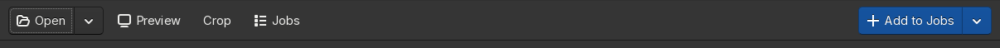  

- #### Open
    The button opens a single source file. Its arrow lists the other ways to open a source: multiple files,
    merging files, a file batch, a Blu-ray folder or image. `Ctrl+O` and `File > Open Video Source File(s)` ask
    for the way first, for more information check out [Open Video Source File(s)](Opening.md).
- #### Preview
    Opens the [Preview](Preview.md), where you can see the result of your filters and cut the video (`F4`).
- #### Crop
    Opens the [Crop](Crop.md) window (`F3`).
- #### Jobs
    Opens the [Jobs](Jobs.md) (`F6`).
- #### Add to Jobs
    Adds the current project as a job to the job list and opens it. It's enabled as soon as the
    [next step](Main.md#next-step) says that the job is ready. Hold `Shift` to add the job at the top of the list
    and `Ctrl` to keep the list closed, the button shows what it will do. The default behavior can be configured
    via [Settings](Settings.md#user-interface). The arrow lists the four ways to add the job.

## Source

The Source card shows the path of the source file and its properties, like its duration, size, bitrate, frame rate,
resolution, color format, HDR format and codec.

Below them the crop size and the pixel aspect ratio (PAR) and display aspect ratio (DAR) of the source are shown.
`PAR` and `DAR` are menus to override the aspect ratio of the source.

The button with the three dots next to the heading opens the source file menu, which also opens with a right-click
on the path:

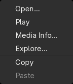  

- #### Open
    Opens the [Open Video Source File(s)](Opening.md) dialog to select a source file.
- #### Play
    Plays the source file with `mpv`.
- #### Media Info
    Shows the MediaInfo of the source file.
- #### Explore
    Opens the folder, that contains the source file, in the file manager.
- #### Copy / Paste
    Copies and pastes the path.

Video files can also be opened by dropping them on the main window.

## Target

The Target card shows the path of the target file and the properties of the encode, like its duration, frame rate,
resolution, the bitrate of all audio tracks and the subtitles.
These data is based on the outcome of the [Frame Servers](../Frame-Servers.md),
so after the [filters](Main.md#filters) are applied.

> :warning: It's important to note, that these information show the state before the script data is passed to the encoder.  
> So the final result can be different depending on the encoder settings.

Next to the heading there are:

- #### Container
    The button shows the container of the target file, `MKV` or `MP4` in most cases. It opens a menu with all
    container profiles, `Edit Profiles...` opens a dialog to edit this list and the containers themselves.
- #### Options
    Opens the [Container Options](Container-Options.md) with the audio tracks, subtitles, attachments, tags and
    chapters of the target file.
- #### Target file menu
    The button with the three dots opens a menu like the one of the source, with `Browse File...` to choose
    another target file.

When the encoder encodes with a bitrate instead of a quality, the card also shows the size of the target file and the
video bitrate. `Size` opens a menu with common sizes.

## Filters

The Filters card is one of the most important parts of StaxRipLinux. The button next to its heading shows the frame
server, `VapourSynth` or `AviSynth`, and opens the menu of the filters.
For more details on that check out [Frame Servers](../Frame-Servers.md).

Below all filters, that are set up, are listed.
On the left there is a checkbox for each filter, so you can enable and disable it quickly.
Next to the checkbox there is the name of the category and then the name of the filter itself.

> :warning: The order is very important as all calls are executed in that order.

> :information_source: The first filter has to be the `Source` filter.  
:information_source: The second one should be the `Crop` filter unless you have good reasons to put something in between them.

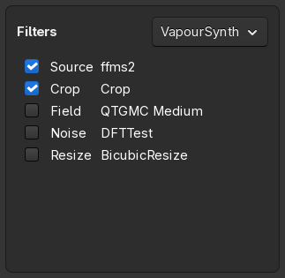  

Filters can be moved via drag&drop easily, in case you have to change the order.  
With a double-click on the list you can open the [Code Editor](Code-Editor.md) directly.  
The button next to the heading and a right-click on a filter open the filter menu:

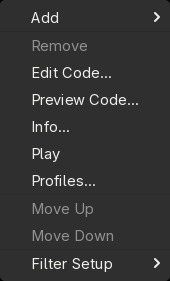  

- #### *Selected filter category*
    The first entry is always the selected filter category, for example *Noise*.  
    This way you can select a different filter of that particular category, which might be useful if you want to try out
    different denoisers, sharpeners or something like that.
- #### Replace
    Replaces the selected filter with the one you choose.
- #### Insert
    Inserts the chosen filter at that exact place - in other words: **before** the selected filter.
- #### Add
    Adds the chosen filter at the bottom end.
- #### Remove
    Removes the selected filter.
- #### Edit Code
    Opens the [Code Editor](Code-Editor.md) to modify the filters.
- #### Preview Code
    Show the resulting script of your setup.
    All macros and values are placed in and all loaded dependencies are included as well. 
    This is the script, that is used to feed the encoder.
- #### Info
    Shows some basic information about the resulting video like resolution, framerate and duration.
    > :information_source: This is the same information you get on the [Preview](Preview.md).
- #### Play
    Plays the resulting script with `mpv`.
- #### Profiles
    Opens the [Filter Profiles window](Filter-Profiles.md), where you can alter and reset the profiles,
    that then can be used to be added to the list of filters.  
    For more information about its handling check out [Filter Profiles](../Filter-Profiles.md).
- #### Move Up/Down
    Obviously to change the order of filters.

    > :warning: Like mentioned above, the order is very important for the processing and outcome.  

    > :information_source: Using drag&drop is easier and faster.  
- #### Filter Setup
    - ##### AviSynth
        Sets **AviSynth+** as the current to use [Frame Server](../Frame-Servers.md).
    - ##### VapourSynth
        Sets **VapourSynth** as the current to use [Frame Server](../Frame-Servers.md).
    - ##### Edit Profiles
        Opens a dialog, that lets you edit, copy, remove, etc. filter setups.  
        > :information_source: Even though they can be useful in some cases,
		you should consider creating a template instead.

## Crop and Resize

The Crop and Resize card gives you the opportunity to resize the given video pretty easy. To do so you can choose
between (custom) pre-defined resolutions as well as a slider.

`Presets` next to the heading opens a menu with pre-defined resolutions to choose from, `Image Options...` opens the
image page of the [Project Options](Project-Options.md) and `Edit Menu...` the editor to customize the resolutions.

Below the actual resolution is shown, separated in `Width` and `Height`. In case the `Resize` filter is active,
you can use the `up`/`down` keys or the mouse wheel to increment/decrement the values by the set `Output Mod` value
in [Project Options](Project-Options.md), by default `2`.  
Alternatively you can move the slider below to adjust the resolution, with `Ctrl` it resizes anamorphic.

Then you get some information about the target image/video:

- #### Crop
    The crop values, set by hand via [Crop](Crop.md) or by `Auto Crop`. `Crop...` opens the [Crop](Crop.md) window.  
    For more information check out [Cropping](../Cropping.md).
- #### DAR
    Display Aspect Ratio, `DAR` opens a menu to set it.
- #### SAR
    Storage Aspect Ratio.
- #### PAR
    Pixel Aspect Ratio, `PAR` opens a menu to set it.
- #### Pixel
    Calculated number of pixels.
- #### Zoom
    Zoom factor in percent indicating the relation of size between the source and the target image.
- #### Error
    Aspect Ratio Error.

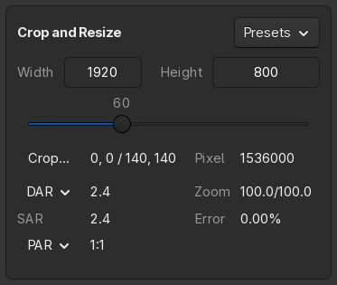  

## Video

The Video card shows the video encoder. The button next to the heading shows the name of the current encoder profile
and opens a menu with all encoder profiles, `Edit Profiles...` opens a dialog to edit this list and the encoders
themselves. `Options...` opens the [Encoder Options](Encoder-Options.md).

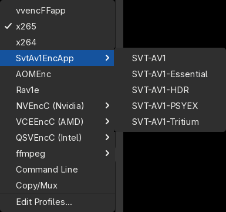  

The card comes in 2 outfits:

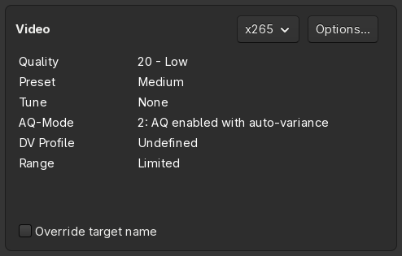  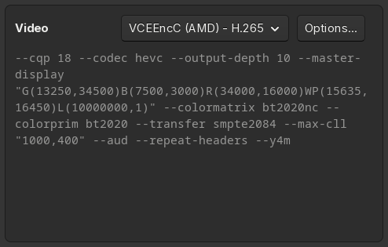  

Encoders like x264, x265, SVT-AV1, vvenc and NVEncC show their most important settings, like the quality and the preset.
A click on a setting opens a menu with its values. `Override target name` enables the
[Override Target File Name](Encoder-Options.md) feature, a right-click on it opens this option in the
[Encoder Options](Encoder-Options.md). Encoders that encode with a bitrate offer the compressibility check.

Other encoders show their command line, `Copy/Mux` copies the video stream without encoding it.

## Audio

The Audio card has a row for each audio track. The text field contains the stream or file name of the source,
next to it there are:

- #### Track menu
    The button with the three dots opens the menu of the track, which also opens with a right-click on the text field.
    It lists the audio streams of the source and the audio files of the temp folder to choose from, `Open File` to
    choose another file, and commands to play the track, show its MediaInfo, explore its folder, process it or
    remove it from the track.
- #### Language
    The language of the track, which is set in its audio settings.
- #### Profile
    The button shows the audio profile of the track and opens a menu with all audio profiles, `Edit Profiles...` opens
    a dialog to edit this list as well as the audio profiles themselves.
- #### Edit
    Opens the audio settings of the track for the current project or template.

`Add Track` next to the heading adds a track and opens its menu, so you can choose a stream or file right away.

> :information_source: The profile `No Audio` lets the audio track being ignored and not muxed to the final result.  
> :information_source: Tracks without a file and with the default profile are hidden, a template shows the tracks
> it sets up. The maximum number of tracks can be set in [Project Options](Project-Options.md).

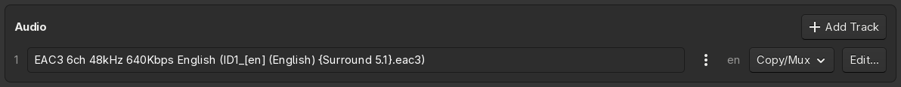  

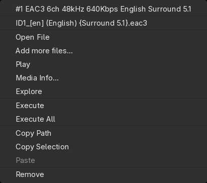  

## Next Step

The bar at the bottom says what needs attention next, so you can check the project before you add the job:

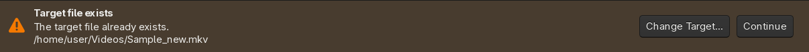  

- A **hint** reminds you of a step you may want to do, like checking the crop or cutting the video.
- A **warning** points out a possible problem, like an existing target file or a high audio delay.
- An **error** has to be resolved before the job can be added, like a container that doesn't support the encoder
  output or a script error.
- When everything is fine, the bar says that the job is **ready** and [Add to Jobs](Main.md#add-to-jobs) is enabled.

The button next to the message opens what resolves it, for example the crop window, the target file dialog or the
encoder options. Hints and warnings can be skipped with `Continue`, the next one is shown then. The controls a
message refers to are outlined.
