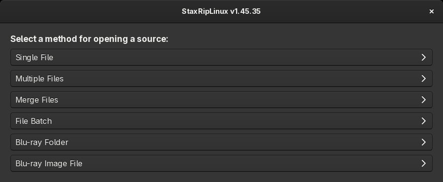
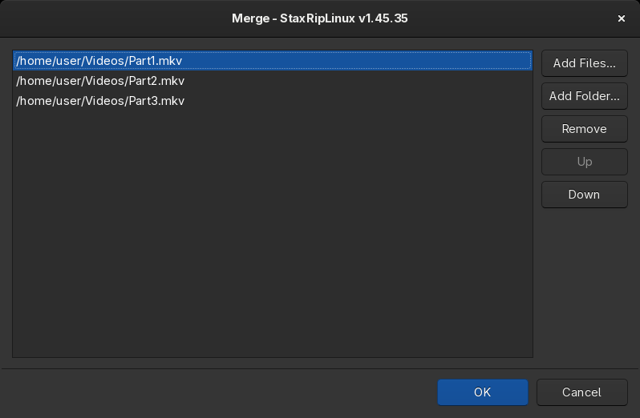
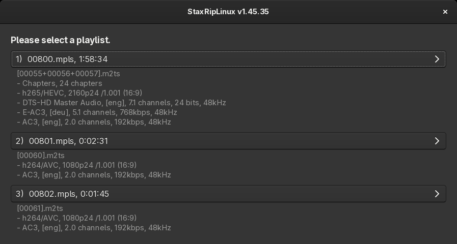
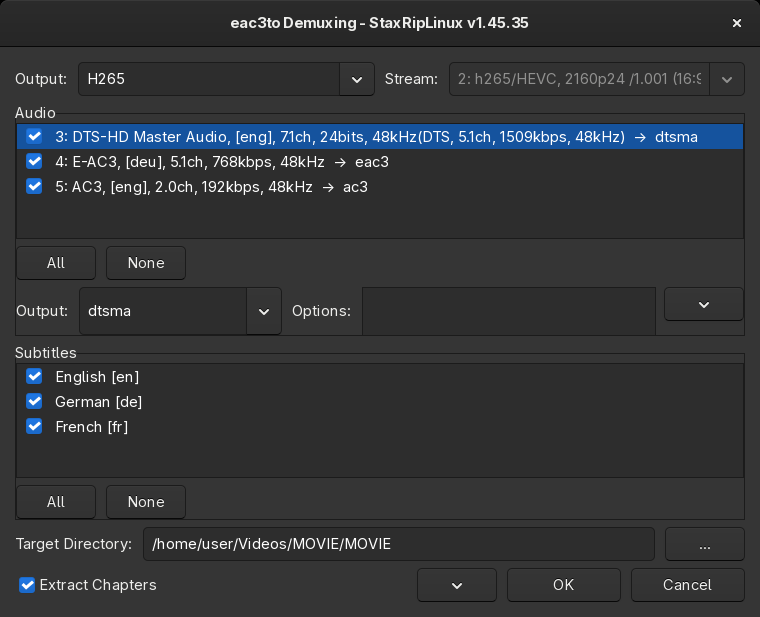

# [Documentation](../../README.md) / [Usage](../README.md) / [User Interface](README.md) / Open Video Source File(s)

- [Ways to open a source](#ways-to-open-a-source)
- [Source Files](#source-files)
- [What happens when a source is opened](#what-happens-when-a-source-is-opened)
- [Blu-ray](#blu-ray)
- [eac3to Demuxing](#eac3to-demuxing)

-----

## Ways to open a source

`File > Open Video Source File(s)` (`Ctrl+O`) asks how the source should be opened:

- #### Single File
    Opens one video file, or an image sequence when the file name ends with a number.
- #### Multiple Files
    Opens several files as one source, for example the VOB files of a DVD title. The demuxers and indexers that
    accept several input files, like D2V Witch, process them together. To join other formats, use *Merge Files*.
- #### Merge Files
    Joins the files into `<first file>_merged` and opens the result. The files must have the same format, resolution
    and tracks. *Merge with* at the bottom of the file list chooses the tool:
    - `mkvmerge` appends the files into an MKV file.
    - `ffmpeg concat demuxer` joins the files and keeps the container of the first file, for example MP4 parts.
    - `ffmpeg concat protocol` joins the bytes of the files, for parts of an MPEG-TS file and for fragmented MP4
      segments (`.m4s`) with their init segment, which is moved to the front. The segments are written to MP4.
    - `Automatic` uses the concat protocol for TS and M4S files, opens MPEG-2 files (`.mpg`, `.vob`) like
      *Multiple Files* and uses mkvmerge for other files.
- #### File Batch
    Adds a job for each file to the [job list](Jobs.md) and opens it. Every job uses the current template and
    settings, the target files are named like the source files. This way many files can be encoded the same way
    without opening each of them.
- #### Blu-ray Folder
    Opens a Blu-ray folder (the folder that contains `BDMV`) and lets you choose the playlist, see [Blu-ray](#blu-ray).
- #### Blu-ray Image File
    Mounts a Blu-ray ISO image with udisks and opens it like a Blu-ray folder.

The arrow of the `Open` button in the toolbar lists the same ways, the button itself opens a single file. Files can
also be dropped on the main window or passed on the [command line](../Command-Line-Interface.md), for example
`staxrip /path/to/video.mkv`.

Before the source is opened, the [Template Selection](Template-Selection.md) can ask which template to use. When a
project with changes is open, StaxRipLinux asks whether to save it first.

## Source Files

*Merge Files* and *File Batch* collect the files in a list first:

`Add Files...` and `Add Folder...` add files, the order of the list is the order of the merged video, `Up` and `Down`
change it. Files can also be dropped on the list.

## What happens when a source is opened

Depending on the [Project Options](Project-Options.md) and the template, StaxRipLinux:

1. reads the media info of the source,
2. runs the [preprocessing](Settings.md#preprocessing) apps that apply to the format, usually mkvextract, MP4Box or
   ffmpeg to demux the audio tracks, subtitles, chapters and attachments into the temp folder,
3. extracts HDR10+ and Dolby Vision metadata if the source has it and the encoder supports it,
4. creates the script of the [frame server](../Frame-Servers.md) with the source filter that is assigned to the format,
   see [Source Filters](Settings.md#source-filters), and indexes the source,
5. applies the crop, resize and other automatic options and sets the target file name.

The *Automatic Workflow* template demuxes the preferred audio tracks and subtitles without asking, the
*Manual Workflow* template opens a dialog to choose the tracks and the source filter. The log file
(`Project > Log File`) shows every step with its command line.

The temp files are written to a folder next to the source that is named like the source file with `_temp` appended,
like `Sample.mkv_temp`, unless another folder is defined under `Project > Options > Paths`.

## Blu-ray

Blu-ray folders and images are opened with [eac3to](https://en.wikibooks.org/wiki/Eac3to), which runs with Wine, see
[Tools](../../Introduction/Linux.md#tools). eac3to lists the playlists of the disc, the main movie is usually the
longest one:

Short playlists are hidden, `Project > Options > Video > Min. duration for BDMV playlists` sets the minimum duration in
seconds. After choosing the playlist, StaxRipLinux asks for a short title, which names the demuxed files and the temp
folder, and opens the [eac3to Demuxing](#eac3to-demuxing) dialog. When the demuxing is finished, the demuxed video is
opened.

### eac3to Demuxing

The dialog lists the streams of the playlist:

- **Output** and **Stream** of the video: the format the video is demuxed to, like `H265` for the raw stream or `MKV`
  for a Matroska file, `Nothing` skips the video.
- **Audio**: the checked streams are demuxed. `All` and `None` check or uncheck all streams, buttons for English and
  the language of the system appear when the streams have these languages. The selected stream gets the output format
  of the **Output** list, for example `flac` for lossless audio or `ac3` to convert it, and the eac3to options of
  **Options**.
- **Subtitles**: the checked subtitles are demuxed as `.sup` files (PGS).
- **Target Directory**: the folder of the demuxed files.
- **Extract Chapters** demuxes the chapters.

The menu button has *Audio Stream Profiles...*, which define the output format and options of audio streams
automatically by their format, for example `flac` for all `DTS Master Audio` streams. It also links the eac3to
wikibook and support forum and runs `eac3to -test` in a terminal.
