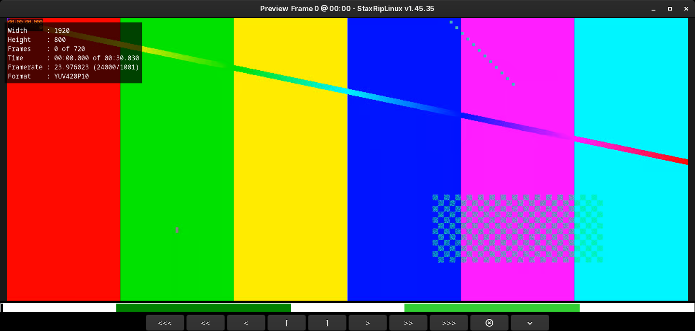

# [Documentation](../../README.md) / [Usage](../README.md) / [User Interface](README.md) / Preview

`Preview` in the toolbar or the main menu (`F4`) opens the preview. It shows the output of the script with all active
filters, the way the encoder gets it, and it's where the video is cut.

The buttons below the video step 100, 10 or 1 frames back and forward, set the start and the end of a cut selection,
delete the selection at the current position and open the menu. A click on the trackbar seeks, the mouse wheel steps
1 frame, with `Ctrl` 10, with `Shift` 100 and with `Alt` 1000 frames, a double-click switches to fullscreen. More than
one preview can be open at the same time, for
example to compare filters.

## Cutting

The cut feature keeps the selected parts of the video and removes the rest:

1. Go to the first frame you want to keep and press `Home` (*Begin Selection*).
2. Go to the last frame you want to keep and press `End` (*End Selection*).
3. Repeat it for every part to keep. The selected parts are green in the trackbar.

`Ctrl+Up` and `Ctrl+Down` jump between the cut points, `S` splits the selection at the current position, `Delete`
removes the selection at the current position and `Ctrl+Delete` all selections. *Create job for each selection*
adds a job for every part instead of one job for all of them.

StaxRipLinux adds a trim filter to the script, so the encode is frame accurate, and cuts the audio tracks the same way,
see *Cutting Method* in the [Project Options](Project-Options.md#audio). Cutting without encoding (`Copy/Mux`) works
only with the MKV container and cuts at the nearest key frames. When a Dolby Vision video is cut, its metadata is
trimmed as well.

## Menu

| Entry | Key | Description |
|---|---|---|
| Navigation | `Ctrl+Left`, `Ctrl+Right` | Go to the start and end |
| | `G`, `T`, `C` | Go to a frame, time or chapter |
| | `Ctrl+Up`, `Ctrl+Down` | Go to the previous and next cut point |
| | `Left`, `Up`, `PageUp`, `-` | 1, 10, 100 and 1000 frames backward |
| | `Right`, `Down`, `PageDown`, `+` | 1, 10, 100 and 1000 frames forward |
| Cut | `Home`, `End` | Begin and end a selection |
| | `S` | Split the selection |
| | `Delete`, `Ctrl+Delete` | Delete the selection or all selections |
| | `E` | Edit the selections as text, one range of frames (`1500-2399`) or times (`0:01:00.000-0:01:30.000`) per line |
| View | `R` | Reload the script, for example after changing a filter |
| | `I` | Show the info of the script: size, frame rate, length and color format |
| | `Enter` | Fullscreen |
| | `=`, `-` | Zoom in and out |
| | `1` | Zoom 100%: a screen pixel for each video pixel, dragging moves the video, `1` again fits it into the window |
| | `B`, `Ctrl+T` | Show or hide the buttons and the trackbar |
| Tools | `F9` | Play the script with mpv from the current position |
| | | Copy the frame number or the time |
| | `Ctrl+P`, `Ctrl+S` | Save the frame as PNG or bitmap, the file name contains the frame number |
| Edit Menu... | `M` | Customizes the menu and its keys, see [Menu Editor](Menu-Editor.md) |
| Help... | `F1` | Shows the help with all keys |
| Exit | `Escape` | Closes the preview |

The size of the window is set in the [Settings](Settings.md#user-interface), the position of the frame number in the
names of saved images in [Settings](Settings.md#generation) > *Generation*.
