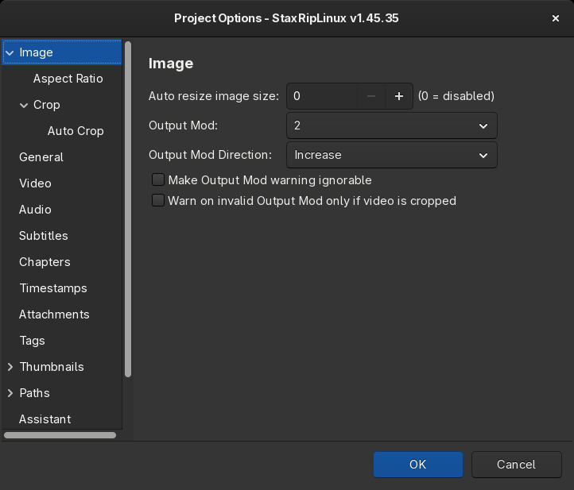
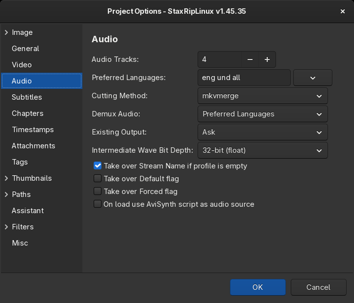

# [Documentation](../../README.md) / [Usage](../README.md) / [User Interface](README.md) / Project Options

`Project > Options` (`F9`) opens the options of the current project. Without source file they belong to the template,
so [saving the template](Save-Template.md) keeps them for all future projects. Global options that apply to every
project are in the [Settings](Settings.md).

The pages are listed on the left, a right-click on an option shows its help.

- [Image](#image)
- [General](#general)
- [Video](#video)
- [Audio](#audio)
- [Subtitles](#subtitles)
- [Chapters, Timestamps, Attachments, Tags](#chapters-timestamps-attachments-tags)
- [Thumbnails](#thumbnails)
- [Paths](#paths)
- [Assistant](#assistant)
- [Filters](#filters)
- [Misc](#misc)

## Image

- **Auto resize image size**: resizes the video after a source is opened, so that it has about the given number of
  pixels (width × height), for example `921600` for 1280×720. The aspect ratio is kept, `0` disables it.
- **Output Mod** and **Output Mod Direction**: width and height of the target are multiples of this value (`2`, `4`,
  `8` or `16`), some encoders and devices need `4` or more. The direction decides whether other values are decreased
  or increased.
- **Make Output Mod warning ignorable** and **Warn on invalid Output Mod only if video is cropped** soften the
  [next step](Main.md#next-step) message about a size that isn't a multiple of the output mod.

### Aspect Ratio

- **Use ITU-R BT.601 compliant aspect ratio**: uses the aspect ratios of the ITU-R BT.601 standard for SD sources,
  which differ slightly from the generic ones.
- **Adjust height according to target display aspect ratio**: when auto resize is disabled, the height follows the
  display aspect ratio.
- **Max AR Error**: the maximum aspect ratio error in percent. Above it, the aspect ratio is signaled to the encoder
  or muxer, so players show the video correctly.
- **Source DAR**, **Source PAR**, **Target DAR**, **Target PAR**: custom aspect ratios for sources whose aspect ratio
  is wrong, for example `16:9` or `1.778`. The `DAR` and `PAR` menus of the main window set them too.

### Crop

- **Auto correct crop values**: crop values that are compatible with the color format (4:2:0 needs even values) and
  the output mod.
- **Auto crop borders until proper aspect ratio is found**: crops the borders further until the aspect ratio error is
  within the limit.
- **Auto overcrop width to limit aspect ratio to**: crops the width as well when the aspect ratio is wider than the
  value, for example for small devices.
- **Tonemapping for HDR videos** and **High contrast for easier cropping**: how the [Crop](Crop.md) window shows the
  video, HDR videos look pale without tonemapping.

### Auto Crop

The options of [Auto Crop](../Cropping.md#auto-crop):

- **Auto Crop after opening**: `Disabled`, `Dolby Vision only` or `Always`.
- **Side Selection Mode**: crop `All Sides`, `Horizontal Only` or `Vertical Only`.
- **Frame Selection Mode** with **Number of frames**, **Frame interval** or **Time interval in seconds**: which frames
  are analyzed.
- **Luminance Threshold in percent**: lines up to this brightness count as black border.
- **Frame Range Mode** with the number of frames ignored at the start and the end, for example to skip logos and
  credits.
- The Dolby Vision options apply to Dolby Vision sources, whose crop values are written into the metadata.

## General

- **Take over title**: uses the title of the source container for the target, the title in the
  [Container Options](Container-Options.md) must be empty.

## Video

- **Existing Video Output**: what happens when the encoded video of a previous run exists: `Ask`, `Overwrite` or
  `Skip`, which reuses it.
- **Demux Video**: demuxes the video stream, for example for remuxing.
- **Take over language**: uses the language of the video stream of the source.
- **Import VUI metadata**: passes color information, like the HDR10 mastering display and light levels, from the
  source to the encoder.
- **Extract HDR metadata**: extracts dynamic HDR10+ and Dolby Vision metadata with hdr10plus_tool and dovi_tool,
  `None`, `HDR10+ only`, `Dolby Vision only` or `All`.
- **Generate Dolby Vision from HDR10+**: generates Dolby Vision profile 8.1 metadata with dovi_tool from the HDR10+
  metadata of sources without Dolby Vision metadata, the mastering display and light levels of the source go to its
  L6 and L9 metadata.
- **Min. duration for BDMV playlists**: playlists of Blu-ray discs that are shorter aren't listed, `-1` uses the
  default of eac3to.
- **Film Threshold for D2V files**: the percentage of film frames from which a D2V source is treated as film.

## Audio

- **Audio Tracks**: the maximum number of audio tracks of the project.
- **Add tracks for more streams**: when the source has more audio streams of the preferred languages than tracks,
  tracks are added for them, up to 25. The added tracks use `Copy/Mux`.
- **Track languages replace missing or wrong languages**: a stream whose language matches no track goes to the next
  free track even if the track has another language, and the tracks keep their language. For sources whose streams
  have no or a wrong language.
- **Preferred Languages**: the languages that are demuxed with *Preferred Languages*, like `eng deu`, `all` for all
  languages. The order decides the order of the tracks.
- **Cutting Method**: `mkvmerge` cuts the audio without decoding it, `FFAudioSource` decodes it with AviSynth+ and
  FFMS2, which is frame accurate.
- **Demux Audio**: `Show Dialog`, `Preferred Languages`, `All` or `None`.
- **Existing Output**: what happens when the encoded audio of a previous run exists, `Ask`, `Overwrite` or `Skip`.
- **Intermediate Wave Bit Depth**: the bit depth of WAV files that are created when an encoder can't decode the source.
- **Take over Stream Name if profile is empty**, **Take over Default flag**, **Take over Forced flag**: copy the
  name and the flags of the source tracks.
- **On load use AviSynth script as audio source**: uses the audio of an opened `.avs` script.

## Subtitles

- **Subtitles**: what happens with the subtitles of the source:
    - *Demux and include all languages*
    - *Demux and include preferred languages*
    - *Demux preferred languages but don't include them*
    - *Include preferred languages directly without demuxing*
    - *Show dialog to choose subtitles to be included*
    - *Don't include subtitles*
- **Types**: `Text and bitmap`, `Text only` or `Bitmap only`, subtitles of the other type aren't demuxed or included.
  PGS, VobSub and DVB subtitles are bitmaps. With OCR, `Text only` still demuxes bitmap subtitles to convert them.
- **Languages**: the preferred subtitle languages, `all` for all languages.
- **Track Name**: the name of the subtitle tracks, may contain [macros](../Macros.md) like `%language_english%`.
- **Default Subtitle**: which subtitle gets the default flag: `None`, `Single`, `First`, `Second`, `English`, `Native`
  (the language of the system), `Default` (the default subtitle of the source) or `DefaultOrFirst`.
- **Convert Sup (PGS/Blu-ray) to IDX (Sub/VobSub/DVD)**: for players and containers without PGS support.
- **Convert bitmap subtitles (PGS, VobSub) to SRT using OCR**: converts the subtitles to text with Tesseract, see
  [Subtitle OCR](../../Introduction/Linux.md#subtitle-ocr). `OCR Languages...` downloads languages.
- **Extract forced subtitles from IDX files**: adds the forced subtitles of a DVD subtitle as separate track.
- **Add hardcoded subtitle**: burns a subtitle into the video, `SRT`, `ASS` and VobSub are supported.

## Chapters, Timestamps, Attachments, Tags

- **Demux Chapters**: demuxes the chapters and adds them to the target.
- **Add chapters at cut points**: when the video is cut, MKV files get a chapter at the start of each kept part,
  named `Part 1`, `Part 2` and so on. Chapters of the source are kept.
- **Extract timestamps from MKV files**: `Never`, `VFR only` or `Always`. Variable frame rate videos keep their
  timing with the timestamps file.
- **Demux Attachments** and **Add Attachments to Muxing**: fonts of ASS subtitles and cover images.
- **Demux Tags** and **Add Tags to Muxing**: the tags of MKV files.

## Thumbnails

The options of the thumbnail sheets, which `Apps > Thumbnails` creates for any video:

- **Create a thumbnail sheet automatically after encoding**
- **Image Format** (`JPEG`, `PNG`, `BITMAP`, `TIFF`), **Quality**, **Background Color** and **Spacer** between the
  thumbs.
- **Header**: whether the sheet has a header with the media info, its font, colors, size and separator.
- **Thumbs**: the timestamp of each thumb (alignment, font, colors, outline), the number of **Columns**, the
  **Rows**, either fixed or by **Interval** in seconds, and the **Width of each thumb**.

## Paths

- **Default Target Folder**: the folder of the target file, empty uses the folder of the source. May contain
  [macros](../Macros.md), `Macros...` lists them.
- **Default Target Name**: the name of the target file without extension, empty uses the name of the source, for
  example `%source_name%_x265`.
- **Temp Files Folder**: the folder of the temp files, empty uses `<source file>_temp` next to the source.
- **Default Thumbnails Path without extension**: where thumbnail sheets are saved, empty saves them next to the video.

### Temp Files

- **Deletion after successful processing**: `Disabled`, `Recycle Bin`, which moves the files to the trash, or
  `Permanent`. Only folders whose name ends with `_temp` are deleted.
- **Selection**: `Everything`, `Selective` with the file types below (project, log, script, index, video, audio and
  subtitle files) or `Custom` with file extensions, **Selection Mode** decides whether they're kept or deleted.
- The frame tolerance values keep the temp files when the frame count of the target differs from the script, which
  indicates an error.

## Assistant

The reminders and warnings of the [next step](Main.md#next-step) bar: remind to crop, to cut, to do the
compressibility check and to set filters, and warn about aspect ratio errors, missing audio and identical audio
tracks.

## Filters

- **Add filter to convert bit depth to**: adds a filter after opening a source that converts it to the given bit
  depth.
- **Add filter to convert chroma subsampling to 4:2:0**: for sources with 4:2:2 or 4:4:4.
- **Add filter to automatically correct the frame rate**: for sources with a slightly wrong frame rate.
- **Auto-rotate video after loading when possible**: for videos with a rotation flag, like smartphone videos.

### Custom

Code that is added to every script StaxRipLinux generates: **Code appended to trim functions**,
**Code inserted at top of scripts** and **Code inserted at bottom of scripts**. It may contain macros.

## Misc

- **Hide dialogs asking to demux, source filter etc.**: uses the defaults without asking, for batch processing.
- **Use source file folder for temp files**: writes the temp files next to the source.
- **Abort on Frame Mismatch**: aborts the job when the frame count of the encoded video differs from the script.
- **Save MediaInfo of the source and the target**: after a job, the complete MediaInfo of the source and the target is
  saved next to the target as `<name>.source.mediainfo.txt` and `<name>.mediainfo.txt`, for metadata like time codes
  that isn't muxed.
- **Auto run compressibility check** with **Percentage of length to check**, **Seconds per test block** and
  **After comp. check adjust** (`image size` or `file size`): the compressibility check encodes parts of the video to
  estimate how well it compresses, see [Encoder Options](Encoder-Options.md#compressibility-check).
