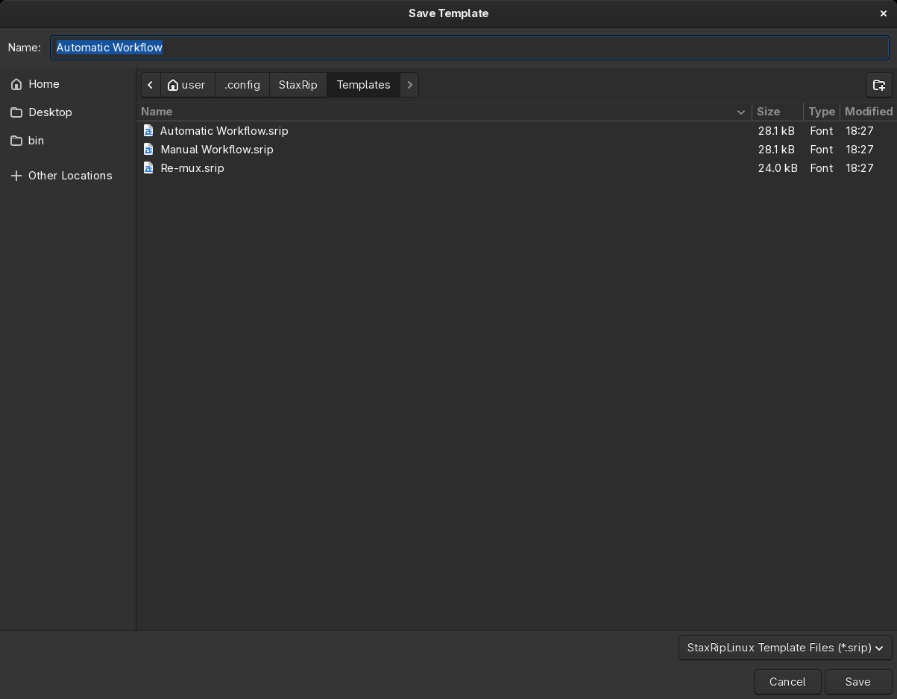

# [Documentation](../../README.md) / [Usage](../README.md) / [User Interface](README.md) / Save Template

`File > Save Project As Template` saves the current project as [template](Template-Selection.md). It's only available
as long as no source file is opened, because a template must not contain a source. To create a template:

1. Load the template that comes closest with `File > Project Templates`, or close the project (`File > Close Project`)
   to start with the startup template.
2. Set up the filters, the encoder, the container, the audio profiles and the [Project Options](Project-Options.md).
3. Choose `File > Save Project As Template` and enter a name.

The dialog opens in the `Templates` folder of the settings, a subfolder of it becomes a submenu of
`File > Project Templates`. Templates saved outside of this folder don't appear in the menu and the
[Template Selection](Template-Selection.md).

To change a template, load it, change it and save it with the same name. To make it the startup template, choose it
under [Settings](Settings.md#startup) > *Startup*.

> [!TIP]
> Templates are a good way to keep setups for different kinds of sources apart, for example one for
> HDR Blu-ray remuxes with x265 and one for old DVDs with deinterlacing and denoising.
