# [Documentation](../../README.md) / [Usage](../README.md) / [User Interface](README.md) / Settings

Via the [main menu](Main.md#main-menu) `Tools » Settings` or by pressing `F10` you can open the Settings.
There you will find everything, that is globally relevant, means not bound to a specific template or project.
The options of a project or template are in the [Project Options](Project-Options.md).
A right-click on an option shows its help.

- [General](#general)
- [Logs](#logs)
- [Startup](#startup)
- [Source Opening](#source-opening)
- [Quality Definitions](#quality-definitions)
- [Generation](#generation)
- [System](#system)
- [User Interface](#user-interface)
- [Frameserver](#frameserver)
- [Preprocessing](#preprocessing)
- [Source Filters](#source-filters)
- [Danger Zone](#danger-zone)

## General

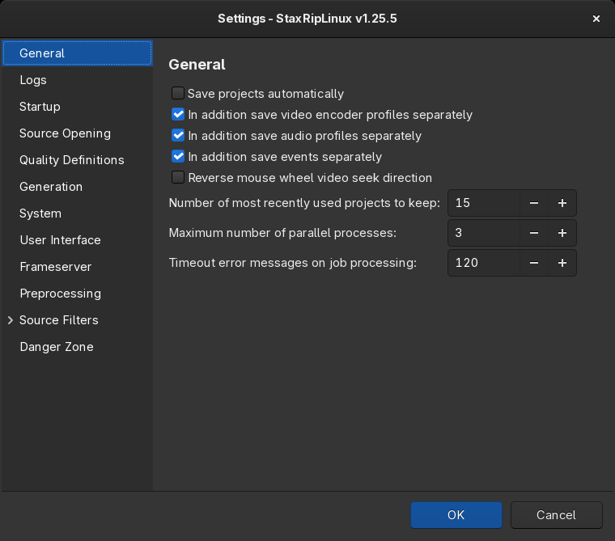  

- **Save projects automatically**  
    Whenever a project is modified and an action is performed, that will close the current project, 
    StaxRipLinux will ask you, if you want to save the latest changes so they don't get lost.
    With this option enabled StaxRipLinux will automatically save the project and don't bother you.  
    :warning: ***They will always overwrite the last configuration, even if you just want to test something out. So be careful!***
- **In addition save video encoder profiles separately**  
    Save video encoder profiles in a separate file called `VideoEncoderProfiles.dat` in the settings folder,
    additional to being saved in `Settings.dat`. Once loaded all information will also be saved to `Settings.dat`.  
    :information_source: If disabled, the separate file will be ignored completely.
- **In addition save audio profiles separately**  
    Save audio profiles in a separate file called `AudioProfiles.dat` in the settings folder,
    additional to being saved in `Settings.dat`. Once loaded all information will also be saved to `Settings.dat`.  
    :information_source: If disabled, the separate file will be ignored completely.
- **In addition save events separately**  
    Save events in a separate file called `Events.dat` in the settings folder,
    additional to being saved in `Settings.dat`. Once loaded all information will also be saved to `Settings.dat`.  
    :information_source: If disabled, the separate file will be ignored completely.
- **Reverse mouse wheel video seek direction**  
    Changes the direction in which the mouse wheel seeks in the [Preview](Preview.md) and [Crop](Crop.md) windows.
- **Number of most recently used projects to keep**  
    The number of projects listed under `File > Recent Projects`.
- **Maximum number of parallel processes**  
    How many processes may run at the same time for audio and video processing, for example audio tracks that are
    encoded while the video is encoded. [Chunk encoding](Encoder-Options.md#chunks) is enabled in the encoder options.
- **Timeout error messages on job processing**  
    How many seconds an error message is shown during job processing before the next job starts.

## Logs

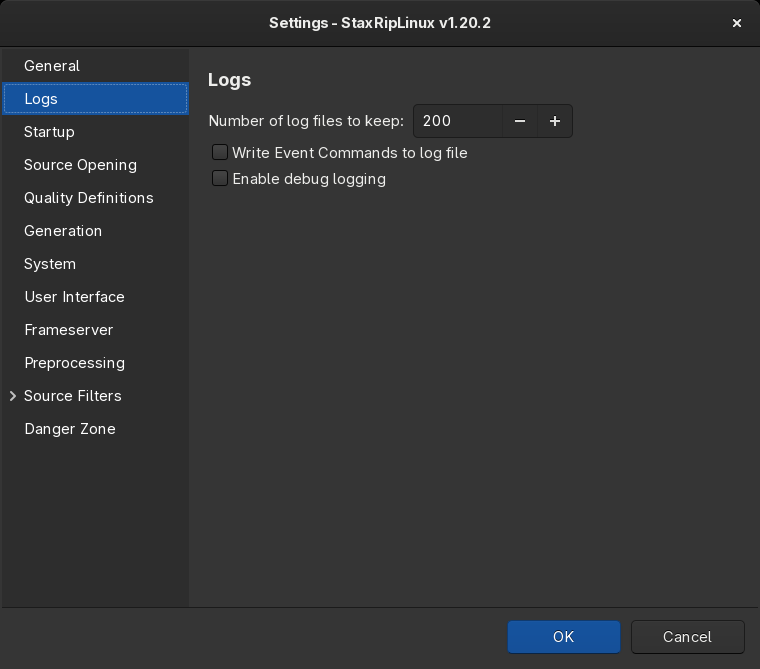  

- **Number of log files to keep**: StaxRipLinux writes the log of a project into its temp folder
  (`<target name>_staxrip.log`) and copies it into `Tools > Folders > Log Files` after each job, which keeps this
  number of logs.
- **Write Event Commands to log file**: logs the [event commands](../Events.md) that are executed.
- **Enable debug logging**: writes additional information that helps to analyze problems.

## Startup

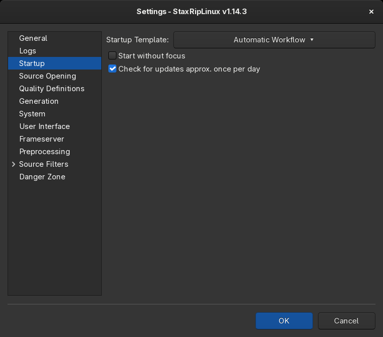  

- **Startup Template**: the [template](Template-Selection.md) that is loaded when StaxRipLinux starts and when a
  project is closed.
- **Start without focus**: StaxRipLinux doesn't take the focus when it starts, for example when it's started by a
  script.
- **Check for updates approx. once per day**: looks for a new release of StaxRipLinux, see
  [Updates](../../Introduction/Linux.md#updates).

## Source Opening

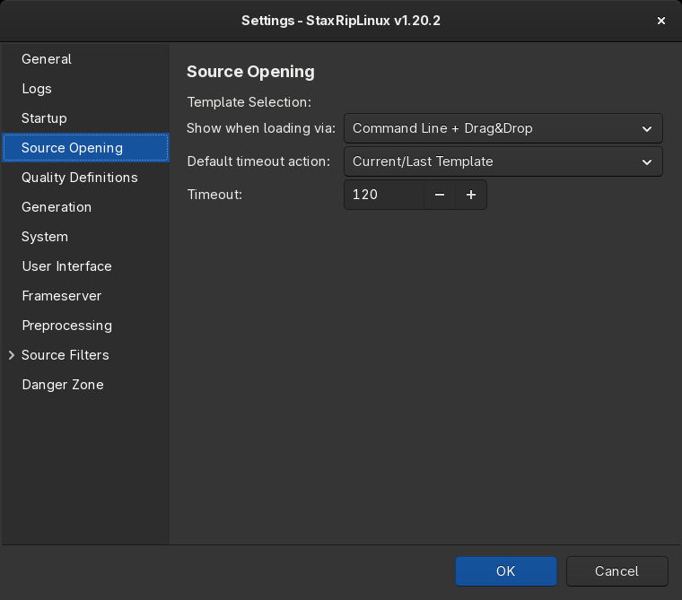  

When the [Template Selection](Template-Selection.md) is shown, which template is used when its countdown runs out and
how long the countdown is.

## Quality Definitions

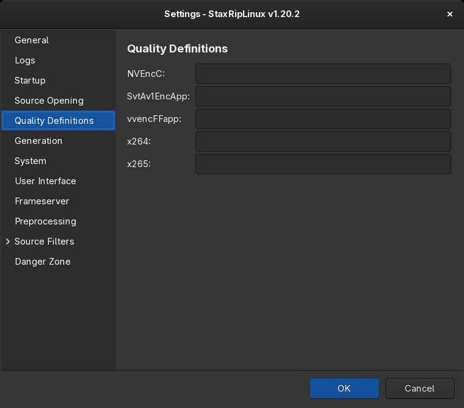  

The quality values that the quality menu of the [Video](Main.md#video) card offers for x264, x265, SvtAv1EncApp,
vvencFFapp and NVEncC. Each value is a number with an optional description in quotes, separated by spaces, for
example:

```
18"High" 20"Personal Default" 22.5 24"Low"
```

## Generation

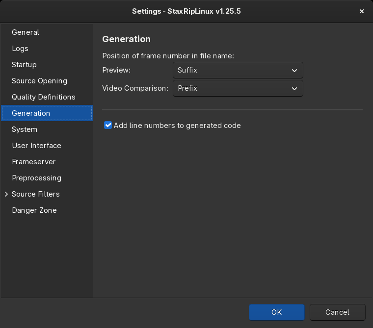  

- **Position of frame number in file name**: whether images saved from the [Preview](Preview.md) and the
  [Video Comparison](Video-Comparison.md) have the frame number as `Prefix` or `Suffix` of the file name.
- **Add line numbers to generated code**: shows line numbers in the code preview of scripts and command lines.

## System

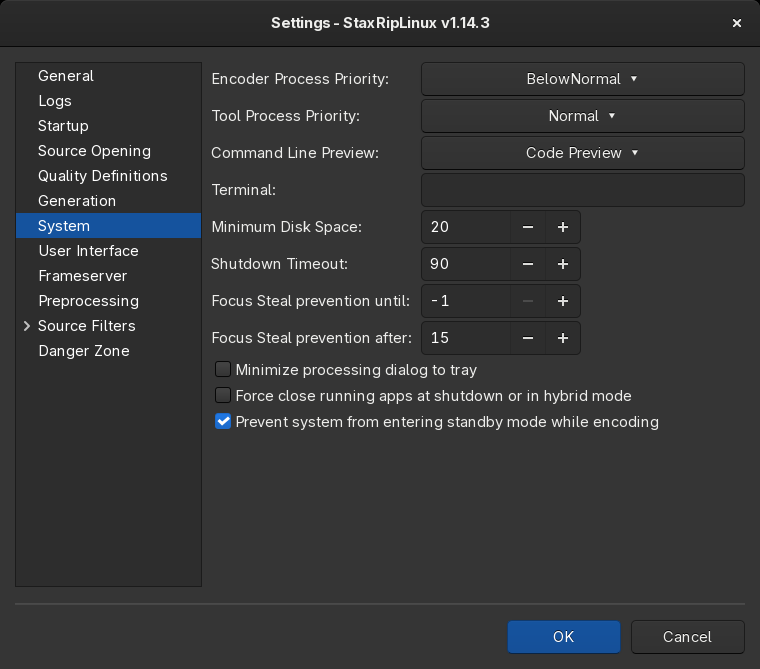  

- **Encoder Process Priority** and **Tool Process Priority**: the priority of the encoders and of the other tools.
  `BelowNormal` or `Idle` keeps the system responsive while encoding.
- **Command Line Preview**: `Code Preview` shows command lines in a window of StaxRipLinux, the other modes show them
  in the terminal.
- **Terminal**: the terminal emulator for console apps, for example `kitty` or `konsole`. Empty uses the `TERMINAL`
  environment variable or a common terminal, see [Desktop integration](../../Introduction/Linux.md#desktop-integration).
- **Minimum Disk Space**: StaxRipLinux shows an error when less space in GB is left.
- **Shutdown Timeout**: the seconds before the computer is shut down after the jobs, when a shutdown mode is chosen in
  the [processing window](Jobs.md#processing).
- **Focus Steal prevention until** and **Focus Steal prevention after**: the main window doesn't take the focus within
  the given seconds after a job has started, or when a job runs longer than the given seconds.
- **Minimize processing dialog to tray**: the processing window becomes a tray icon when it's minimized, on desktops
  that show tray icons.
- **Force close running apps at shutdown or in hybrid mode**
- **Prevent system from entering standby mode while encoding**: inhibits standby with `systemd-inhibit` or
  `elogind-inhibit` while jobs run.

## User Interface

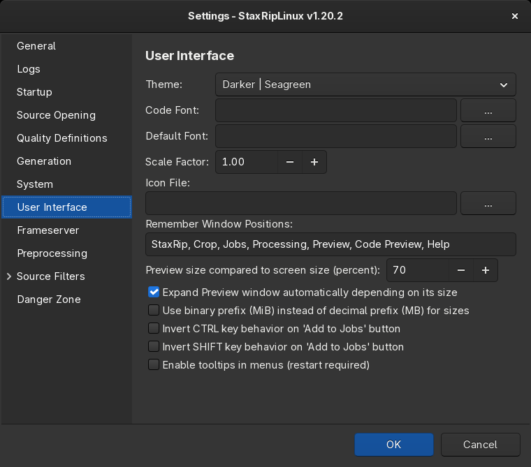  

- **Theme**: the colors of highlighting and other content StaxRipLinux draws itself. The controls use the GTK theme,
  the StaxRipLinux themes are only used with a dark GTK theme.
- **Code Font** and **Default Font**: see [Fonts](../Fonts.md).
- **Scale Factor**: scales the fonts and controls, a restart is required.
- **Remember Window Positions**: the titles or beginnings of titles of windows whose position and size are
  remembered, `all` for all windows.
- **Preview size compared to screen size (percent)** and **Expand Preview window automatically depending on its size**:
  the size of the [Preview](Preview.md) window.
- **Use binary prefix (MiB) instead of decimal prefix (MB) for sizes**: 1 MiB = 1024 KiB, 1 MB = 1000 KB. External
  tools aren't affected.
- **Invert CTRL key behavior on 'Add to Jobs' button** and **Invert SHIFT key behavior on 'Add to Jobs' button**: by
  default `Add to Jobs` adds the job at the bottom of the list and opens it, `Shift` adds it at the top and `Ctrl`
  keeps the list closed, see [Add to Jobs](Main.md#add-to-jobs).
- **Enable tooltips in menus**: menus show their help as tooltips, a right-click on a menu item always shows it.

## Frameserver

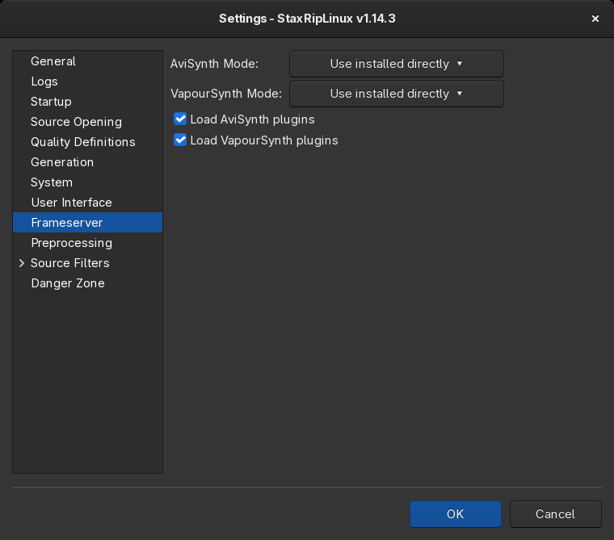  

- **AviSynth Mode** and **VapourSynth Mode**: `Use portable directly` uses AviSynth+ and VapourSynth of the full
  AppImage, if it has them, `Use installed directly` the ones installed on the system. A restart is required. See
  [Frame Servers](../Frame-Servers.md).
- **Load AviSynth plugins** and **Load VapourSynth plugins**: StaxRipLinux detects the plugins a script uses and adds
  the calls that load them, so plugins don't have to be in the folders the frame servers load automatically.

## Preprocessing

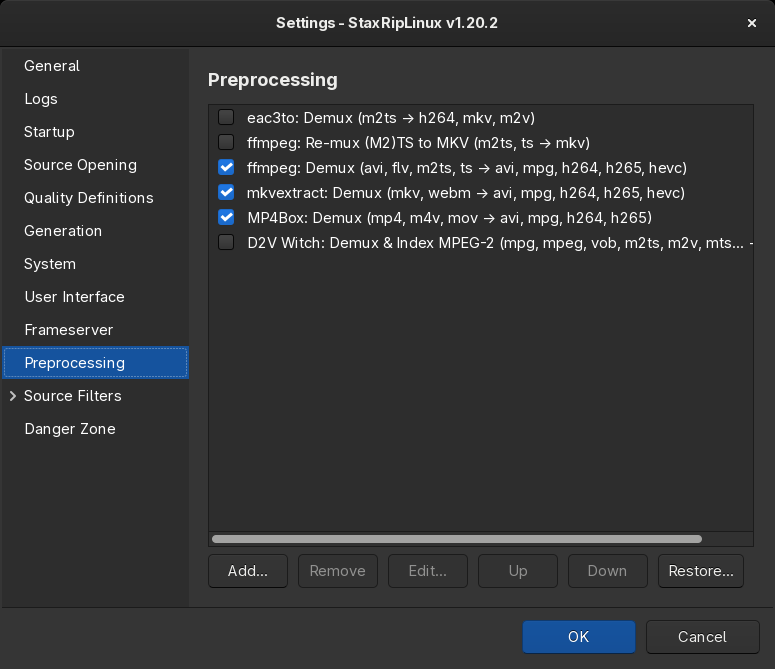  

The preprocessing apps run one after another when a source is opened, so each one can use the output of the previous
one. They demux, index or re-mux the source:

- **eac3to: Demux**, inactive by default
- **ffmpeg: Re-mux (M2)TS to MKV**, inactive by default, re-muxes H.264 and HEVC transport streams to MKV
- **ffmpeg: Demux**, **mkvextract: Demux** and **MP4Box: Demux**, demux the tracks of the formats they support
- **D2V Witch: Demux & Index MPEG-2**, inactive by default, indexes MPEG-2 sources for the d2v source filters

Each app defines the input extensions and formats it processes, `Edit...` changes them and the command line of custom
apps. `Add...` adds a demuxer or a custom app with a command line that may contain [macros](../Macros.md), `Restore...`
restores the defaults.

## Source Filters

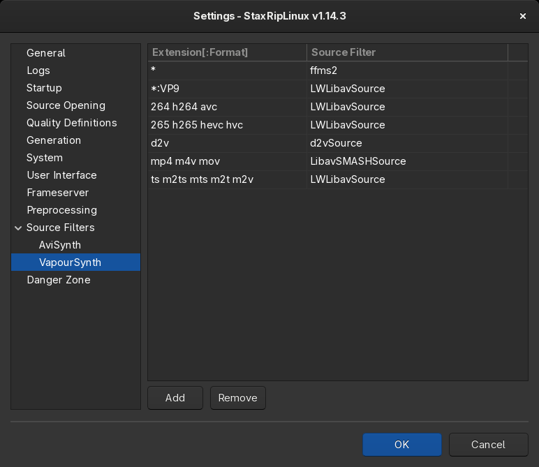  

There is a page for AviSynth and one for VapourSynth. Each row assigns a source filter to file extensions, separated
by spaces, optionally followed by a format, like `ts m2ts` or `*:vp9`, `*` stands for any extension. When a source is
opened with the *Automatic* source filter, StaxRipLinux looks for a row with the extension and the format of the source
first, then for a row with the format and any extension, then for the extension only and finally for `*`. Source
filters that aren't installed are skipped. The source filters themselves are profiles of the filters menu, see
[Filter Profiles](../Filter-Profiles.md).

## Danger Zone

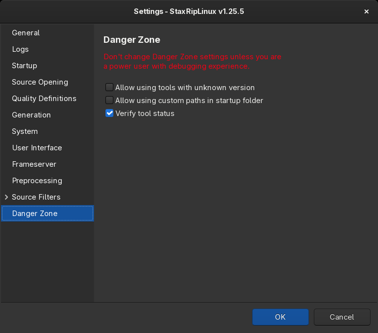  

Don't change these settings unless you are a power user with debugging experience.

- **Allow using tools with unknown version**: tools whose version StaxRipLinux doesn't know are used without
  asking.
- **Allow using custom paths in startup folder**
- **Verify tool status**: checks all required tools before a job runs and shows the [Apps Manager](Apps-Manager.md)
  when one is missing or has an unknown version.
