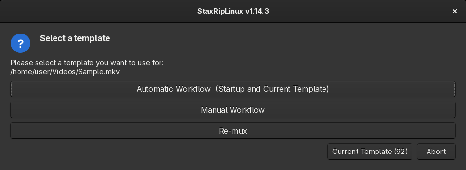

# [Documentation](../../README.md) / [Usage](../README.md) / [User Interface](README.md) / Template Selection

A template is a project without source file. It contains all project options, the filters, the encoder, the container
and the audio profiles, so every source opened with it starts with the same setup. Templates are `.srip` files in the
`Templates` folder of the settings (`Tools > Folders > Templates`), subfolders appear as submenus of
`File > Project Templates`. StaxRipLinux comes with three templates:

- **Automatic Workflow**, the startup template: demuxes the preferred audio tracks and subtitles and chooses the
  source filter by the format without asking.
- **Manual Workflow**: asks which tracks to demux and which source filter to use.
- **Re-mux**: copies video and audio without encoding (`Copy/Mux`), for example to change the container or to cut.

When a source is opened, the template selection can ask which template to use:

The first entry keeps the current template, or the template that was used last when a project is open. The other
entries are the startup template, the templates of the folder and its subfolders (`. .` goes up again). A button at the
bottom is chosen automatically when the countdown runs out.

When the selection is shown is set under [Settings](Settings.md#source-opening) > *Source Opening*:

- **Show when loading via**: `Never`, only for sources from the command line, drag & drop or the opening menu, or
  combinations of them, or `Always`. By default it's shown for the command line and drag & drop.
- **Default timeout action**: what happens when the countdown runs out: `None` shows no countdown, `Abort` cancels the
  opening, `Current/Last Template` and `Startup Template` use that template.
- **Timeout**: the countdown in seconds.

The template that is loaded when StaxRipLinux starts is set under [Settings](Settings.md#startup) > *Startup*.
New templates are created with [Save Template](Save-Template.md).
