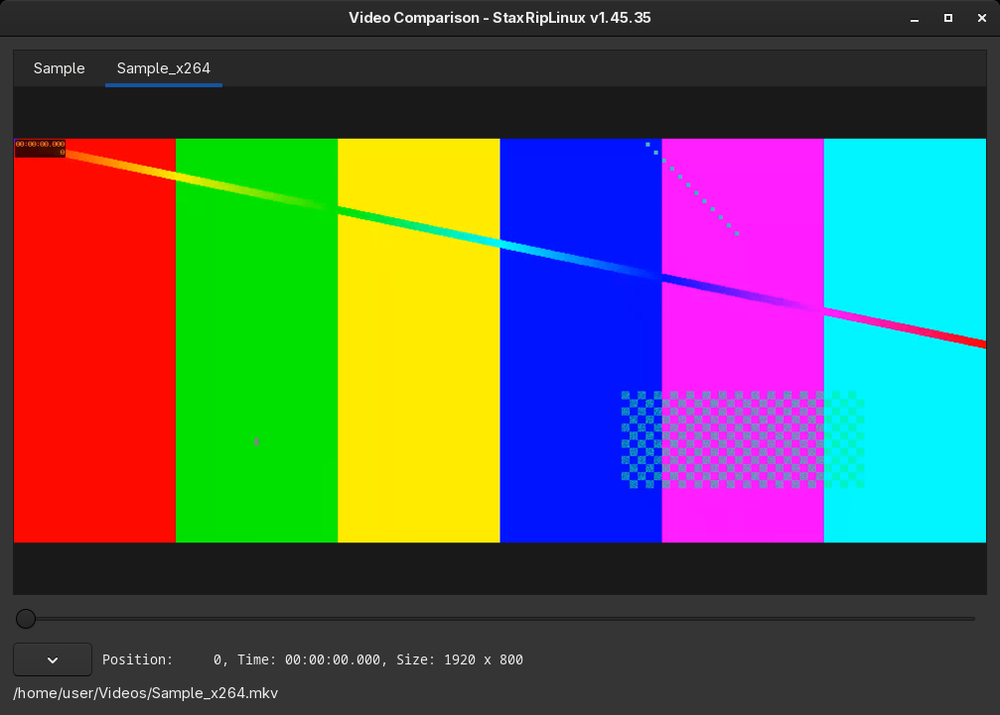

# [Documentation](../../README.md) / [Usage](../README.md) / [User Interface](README.md) / Video Comparison

`File > Video Comparison` compares videos frame by frame, for example the source and an encode, or encodes with
different settings. Every video gets a tab, all tabs show the same frame, so switching the tabs shows the differences.
When the window opens, it adds the source of the project and its target file, if it exists already, otherwise it asks
for the files.

The videos are opened with a source filter of the current [frame server](../Frame-Servers.md), images with an image
source. The line below the slider shows the position, the time and the size of the current tab, the menu button next
to it and a right-click on the video open the menu.

| Entry | Key | Description |
|---|---|---|
| Add files to compare... | `O` | Opens videos, several can be selected at once |
| Close selected tab | `Delete` | Closes the current tab |
| Select next tab | `Space` | Switches to the next tab |
| Save PNGs at current position | `S` | Saves the current frame of every tab as PNG next to its video |
| Crop and Zoom... | `C` | Crops all videos the same way, to look at a detail |
| Go To Frame..., Go To Time... | `F`, `T` | Jumps to a frame or time |
| Navigate | `Left`, `Right`, `Ctrl+Left`, `Ctrl+Right` | 1 or 100 frames back and forward |
| Reload all tabs | `R` | Reloads the videos, for example after a new encode |
| Help | `F1` | Shows the help with all keys |

Videos with a different frame count or frame rate don't line up, cut or encode them the same way before comparing.

> [!TIP]
> When x265 writes a CSV log with frame level statistics (*Log Level Frame* and a CSV file on the statistics page of the
> x265 options), the video comparison shows the frame type and other information of each frame.
