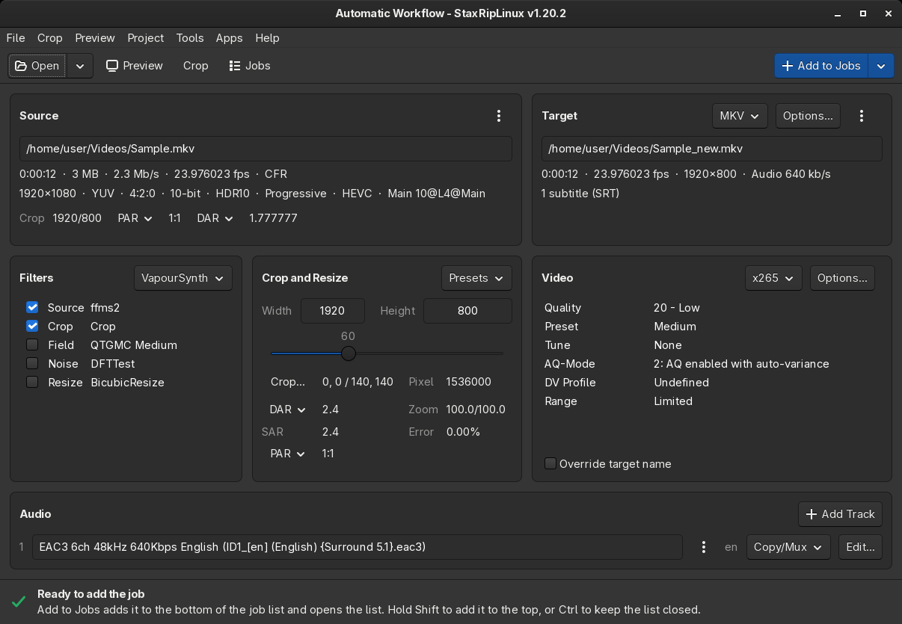

# [Documentation](../README.md) / [Usage](README.md) / Workflow

StaxRipLinux doesn't force a fixed order of steps: every setting can be changed at any time, and the
[next step](User-Interface/Main.md#next-step) bar at the bottom of the main window says what needs attention. A
typical encode looks like this:

1. **Choose a template**, or keep the startup template. A [template](User-Interface/Template-Selection.md) sets up
   everything for a kind of source, so most sources need only a few changes.
2. **Open the source** with `Open` in the toolbar, by dropping it on the main window or from the command line, see
   [Open Video Source File(s)](User-Interface/Opening.md). StaxRipLinux demuxes the audio and subtitles, indexes the
   video and creates the script.
3. **Check the source** on the [Source](User-Interface/Main.md#source) card: resolution, frame rate, interlacing, HDR.
4. **Set the filters** on the [Filters](User-Interface/Main.md#filters) card, for example a deinterlacer for
   interlaced sources or a denoiser for noisy ones. The [Preview](User-Interface/Preview.md) shows the result.
5. **Crop and resize** on the [Crop and Resize](User-Interface/Main.md#crop-and-resize) card, the
   [Crop](User-Interface/Crop.md) window shows the crop values on the video.
6. **Cut** the video in the [Preview](User-Interface/Preview.md#cutting) if only a part of it should be encoded.
7. **Choose the encoder** and its quality on the [Video](User-Interface/Main.md#video) card, the
   [Encoder Options](User-Interface/Encoder-Options.md) have all options.
8. **Set up the audio** on the [Audio](User-Interface/Main.md#audio) card: copy the tracks or encode them, set their
   languages.
9. **Choose the container** and its options on the [Target](User-Interface/Main.md#target) card: subtitles, chapters,
   attachments.
10. **Add the job** with [Add to Jobs](User-Interface/Main.md#add-to-jobs) and start it in the
    [Jobs](User-Interface/Jobs.md) window.

While the job runs, StaxRipLinux processes the audio tracks, encodes the video with the frame server script, muxes
everything into the target file and writes the [log file](User-Interface/Log-File-Viewer.md).

## Batch processing

To encode many files the same way, set up the template, then open them with *File Batch*. Every file becomes a job
with this setup, see [Opening](User-Interface/Opening.md#ways-to-open-a-source). Without template changes, the
*Hide dialogs asking to demux, source filter etc.* option of the [Project
Options](User-Interface/Project-Options.md#misc)
avoids questions while the jobs run.

## Projects

The current state can be saved as project (`File > Save Project`, `.srip`) and opened again later. The jobs of the job
list are projects as well, `Load` in the [Jobs](User-Interface/Jobs.md) window opens them. `File > Recent Projects`
lists the last projects.

For a step by step introduction, see [First Time Encode](../Guides/First-Time-Encode.md).
