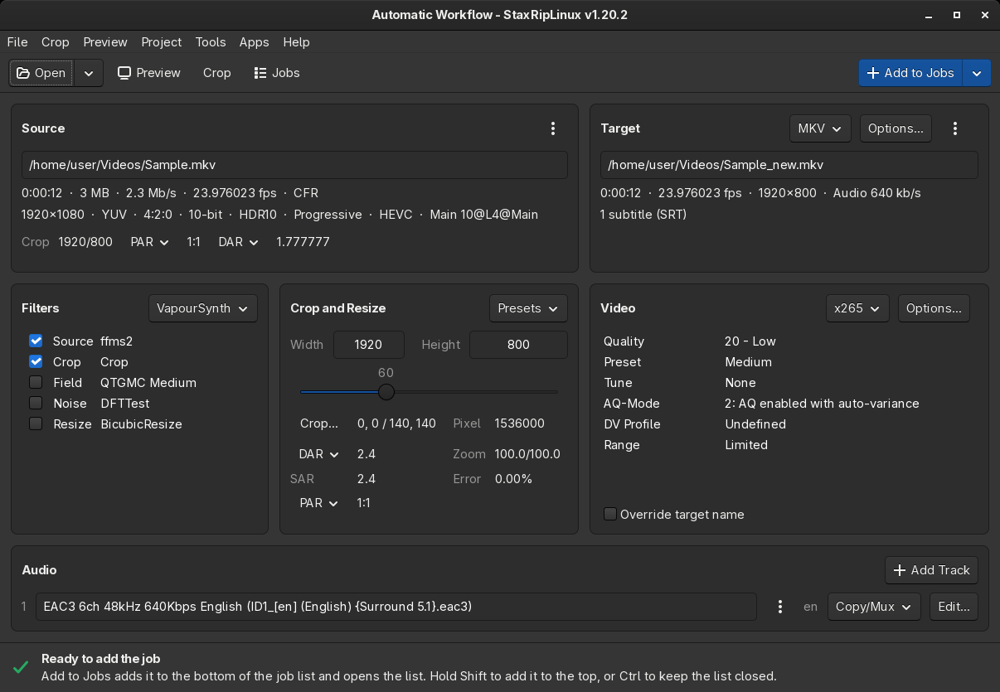
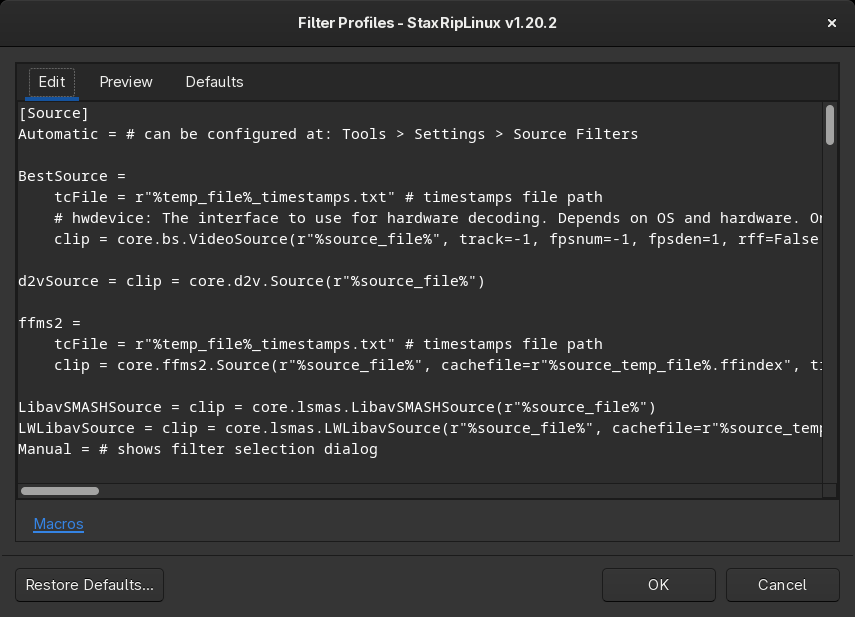
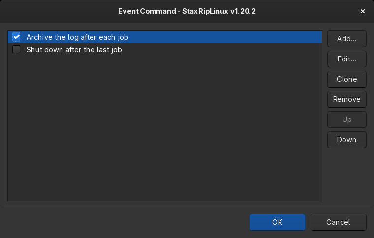
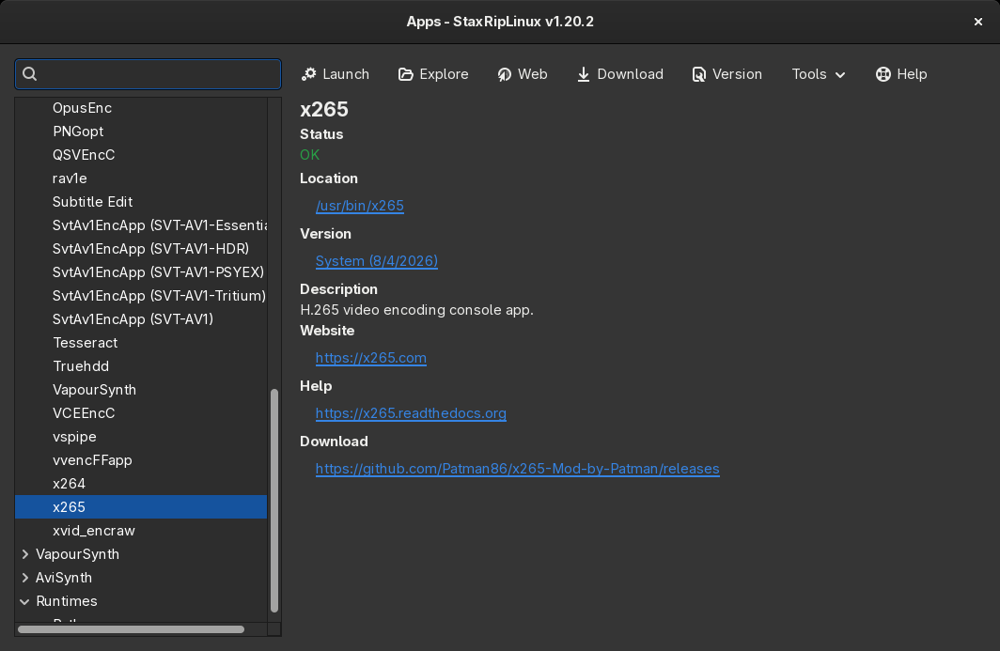
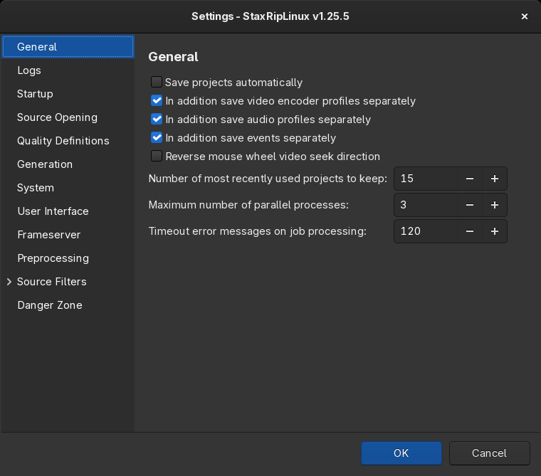

[&color=hsl(110%2C%2060%25%2C%2050%25))](https://github.com/SwiftFly78/staxripLinux/releases/latest)
[&color=hsl(110%2C%2060%25%2C%2050%25))](License.txt)
[&color=hsl(110%2C%2060%25%2C%2050%25))](https://github.com/SwiftFly78/staxripLinux/releases)
[&color=hsl(210%2C%2060%25%2C%2050%25))](https://discord.gg/uz8pVR79Bd)  
[&color=hsl(210%2C%2060%25%2C%2050%25))](https://www.patreon.com/Dendraspis)
[&color=hsl(210%2C%2060%25%2C%2050%25))](https://ko-fi.com/Dendraspis)
[&color=hsl(210%2C%2060%25%2C%2050%25))](https://www.buymeacoffee.com/Dendraspis)

-------------

# About

StaxRipLinux is a powerful video/audio encoding GUI for Linux, based on [StaxRip](https://github.com/staxrip/staxrip).
It executes and controls console apps such as x265, mkvmerge, ffmpeg, etc. and uses scripting based frame servers,
AviSynth+ and VapourSynth, for video processing. Each project can also be extended by various events and settings.

***StaxRipLinux is no One-Click Encoder!***  
StaxRipLinux is capable of performing a wide variety of jobs for video/audio processing. To unleash its full power,
users are required to know what they want to achieve and how to set up StaxRipLinux to meet their needs.
If you are a first-time user, it is especially strongly recommended that you learn the basics referring to the
[documentation](Docs/README.md) and do some tests to understand how StaxRipLinux works and what you can achieve with
it. However, the next step at the bottom of the main window guides you through your jobs step by step so that you can
start more easily and prevent mistakes.

# Installation

The [releases](https://github.com/SwiftFly78/staxripLinux/releases/latest) contain StaxRipLinux as AppImage, a
single file that runs without installation. Both AppImages contain the .NET runtime:

- `StaxRipLinux-<version>-x86_64.AppImage` also contains the tools and plugins StaxRipLinux works with, like the
  encoders, FFmpeg, MKVToolNix and the frame servers AviSynth+ and VapourSynth with their plugins. It runs on
  distributions with glibc 2.35 or newer, like Ubuntu 22.04, Debian 12 and Fedora 36.
- `StaxRipLinux-<version>-slim-x86_64.AppImage` uses the tools installed on the system, see
  [Requirements](Docs/Introduction/Linux.md#requirements).

Make the file executable and start it:

```sh
chmod +x StaxRipLinux-*-x86_64.AppImage
./StaxRipLinux-*-x86_64.AppImage
```

AppImages need FUSE, which the package `fuse3` provides. Without FUSE, start the AppImage with
`--appimage-extract-and-run`. Tools like Gear Lever or AppImageLauncher add AppImages to the application menu.

StaxRipLinux can also be [built from source](Docs/Introduction/Linux.md#building) and
[installed](Docs/Introduction/Linux.md#installation) with its install script, it then uses the tools of the system
like the slim AppImage.

## Settings and versions

StaxRipLinux stores its settings in `~/.config/StaxRip`. A folder next to the AppImage with its name and `.config`
appended, like `StaxRipLinux-<version>-x86_64.AppImage.config`, keeps them next to the AppImage instead, so different
versions can be used side by side with their own settings.

The title bar shows the version, *Help > What's new...* lists the changes of every version. *Help > Check for Updates*
finds new releases and downloads their AppImage, see [Updates](Docs/Introduction/Linux.md#updates). The settings of
different versions can be incompatible, which can lead to unwanted side effects like missing functionality or changed
encoder parameters. It is also **very important** to **not** run existing jobs with a different version, as some encoder
parameters could have been changed and mess up the values. This is pretty rare, but it can happen.

# Documentation

- The [documentation](Docs/README.md) describes the user interface and its options, the frame servers, macros,
  commands and the command line interface, and has guides for the first encode, the encoders and the frame servers.
- [Linux](Docs/Introduction/Linux.md) describes the requirements, the AppImages, how StaxRipLinux finds tools and
  plugins, building, installation and troubleshooting.
- The [releases](https://github.com/SwiftFly78/staxripLinux/releases) list the changes of every version.

# Contribution / Support

StaxRipLinux is free to use under the [MIT license](License.txt). If you want to contribute, you can report issues or
open pull requests for bug fixes and extensions, see [Contribution](Docs/Contribution/README.md).

### **Bug Reports / Feature Requests**
- Please try the [latest release](https://github.com/SwiftFly78/staxripLinux/releases/latest) first. Usually you
  will find that many outstanding bugs are already fixed in the latest version.
- The release notes of the newer versions show whether there is an entry already made for the bug/feature request you
  are experiencing/desiring.
- If the latest release does not solve your problem, please use the
  [issue tracker](https://github.com/SwiftFly78/staxripLinux/issues). Be as precise as possible: name the version from
  the title bar, the distribution and the AppImage or tools you use, and attach the log file.

### Community
- Feel free to join in the [StaxRip Community on Discord](https://discord.gg/uz8pVR79Bd), where you can chat and share
  knowledge with other StaxRip users. This is the way to go if you have questions regarding settings, usage, etc.
- Usage questions can also be asked on the *StaxRip threads* on
  - [VideoHelp](https://forum.videohelp.com/threads/369913-StaxRip-support-thread)
  - [Doom9](https://forum.doom9.org/showthread.php?t=172068)

  although no developer or contributor is active there anymore.

### **Donation**
StaxRipLinux is based on StaxRip. If you want to donate to support StaxRip and keep it alive, you can do it by using
those links:

- [&color=hsl(210%2C%2060%25%2C%2050%25))](https://www.patreon.com/Dendraspis) https://www.patreon.com/Dendraspis
- [&color=hsl(210%2C%2060%25%2C%2050%25))](https://ko-fi.com/dendraspis) https://ko-fi.com/Dendraspis
- [&color=hsl(210%2C%2060%25%2C%2050%25))](https://www.buymeacoffee.com/dendraspis) https://www.buymeacoffee.com/Dendraspis

Any contribution is highly appreciated!

# Screenshots










